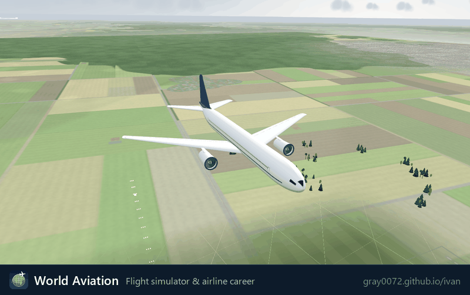
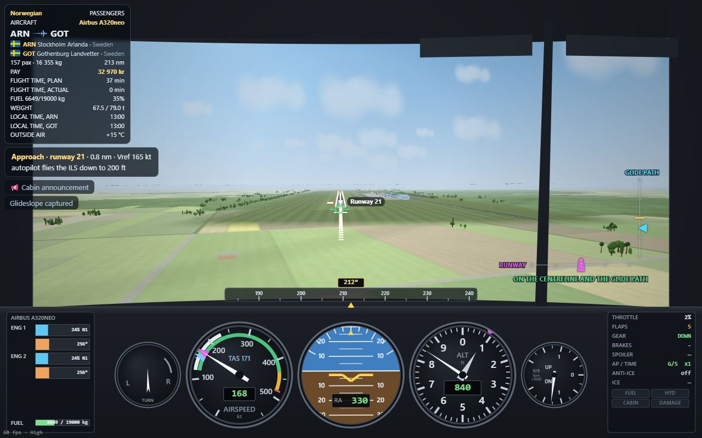
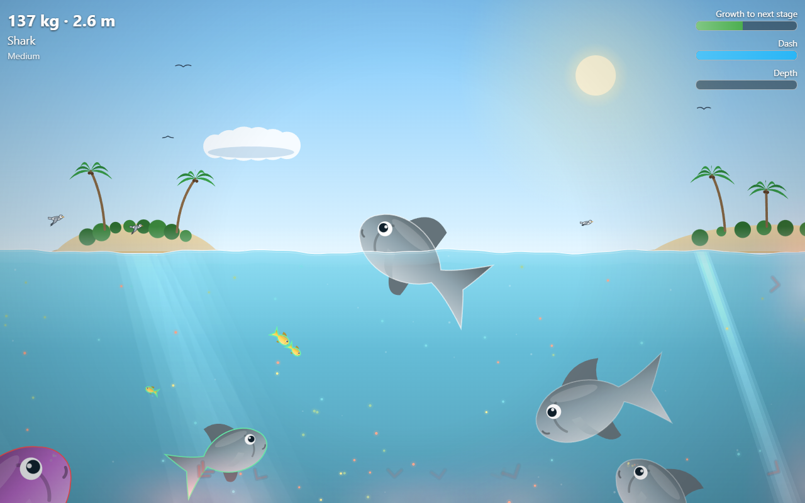
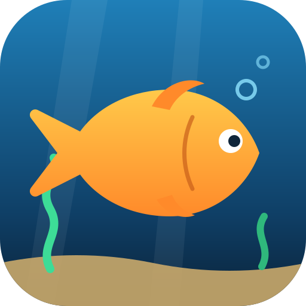
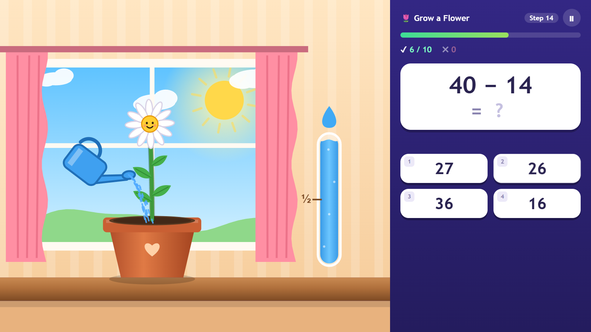
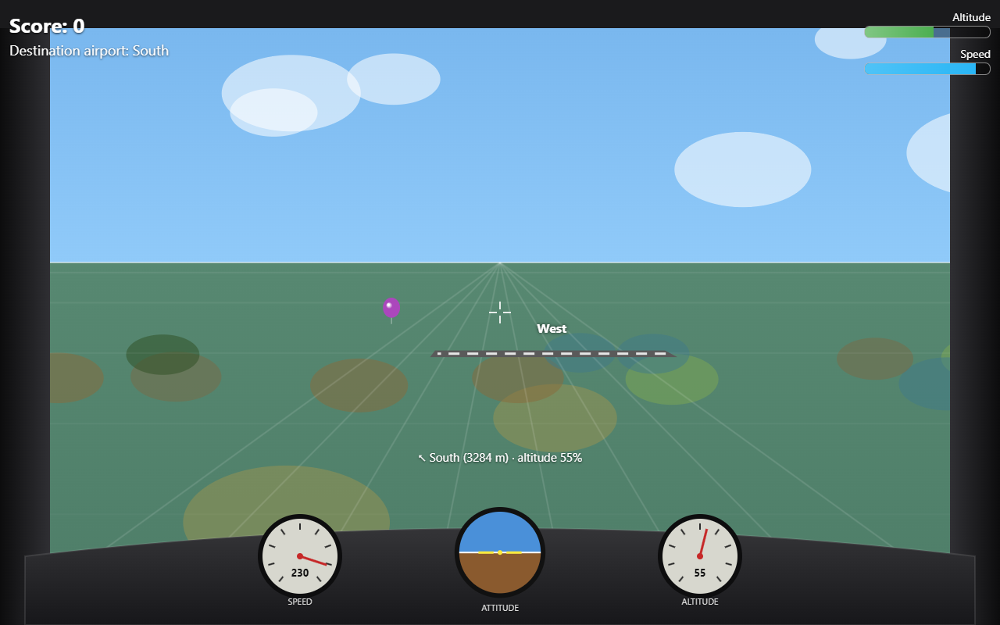
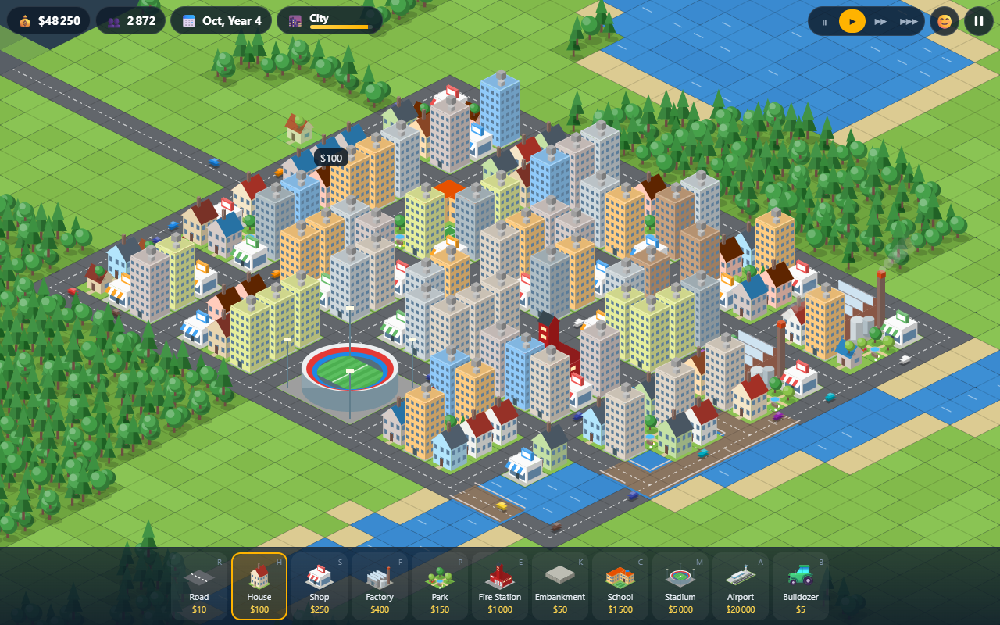

<div align="center">


# Browser Games Gallery

**Tiny self-contained browser games in vanilla JavaScript. No install — just open and play.**

[](https://gray0072.github.io/ivan/)


[](LICENSE)

*[Читать на русском](README_RU.md)* · *[Läs på svenska](README_SV.md)*

<a href="https://gray0072.github.io/ivan/"></a>

</div>

## 🎮 Games

<table>
  <tr>
    <td width="50%" valign="top">
      <a href="https://gray0072.github.io/ivan/world-aviation/"></a>
      <h3> World Aviation</h3>
      <p>Cockpit-view flight simulator and airline career: from Swedish domestic hops out of Arlanda to the whole world. Push back, taxi, fly the ILS, land and park at the gate.</p>
      <p><a href="https://gray0072.github.io/ivan/world-aviation/"><b>▶ Play</b></a> · <a href="world-aviation/">Source</a></p>
    </td>
    <td width="50%" valign="top">
      <a href="https://gray0072.github.io/ivan/fish-frenzy/"></a>
      <h3> Fish Frenzy</h3>
      <p>Eat-and-grow arcade: eat plankton and smaller fish, dodge bigger ones and jellyfish, and climb the food chain to the Sea King.</p>
      <p><a href="https://gray0072.github.io/ivan/fish-frenzy/"><b>▶ Play</b></a> · <a href="fish-frenzy/">Source</a></p>
    </td>
  </tr>
  <tr>
    <td width="50%" valign="top">
      <a href="https://gray0072.github.io/ivan/fun-training/"></a>
      <h3> Fun Training</h3>
      <p>A training game for school kids: answer tasks in time to water a flower, stop the zombies or keep a panda fed, then spend the coins on your own character.</p>
      <p><a href="https://gray0072.github.io/ivan/fun-training/"><b>▶ Play</b></a> · <a href="fun-training/">Source</a></p>
    </td>
    <td width="50%" valign="top">
      <a href="https://gray0072.github.io/ivan/flight-simulator/"></a>
      <h3> Flight Simulator</h3>
      <p>First-person arcade flight: pop balloons with the twin gun for points and land on the highlighted airport's runway.</p>
      <p><a href="https://gray0072.github.io/ivan/flight-simulator/"><b>▶ Play</b></a> · <a href="flight-simulator/">Source</a></p>
    </td>
  </tr>
  <tr>
    <td width="50%" valign="top">
      <a href="https://gray0072.github.io/ivan/city-builder/"></a>
      <h3> City Builder</h3>
      <p>City-building game: lay roads, build houses, shops and factories, keep the residents happy and grow a hamlet into a metropolis — mind the fires and the spring floods.</p>
      <p><a href="https://gray0072.github.io/ivan/city-builder/"><b>▶ Play</b></a> · <a href="city-builder/">Source</a></p>
    </td>
    <td width="50%" valign="top"></td>
  </tr>
</table>

## ✨ Highlights

- **Zero install** — runs straight in the browser on desktop and mobile, and installs to the home screen as an app.
- **Touch controls** — on-screen joysticks and buttons on phones and tablets, keyboard and mouse on desktop.
- **Pure web platform** — Canvas 2D and WebGL for graphics, Web Audio for synthesized sound. No frameworks, no build step.
- **Self-contained** — each game lives in its own folder and still works when copied out of the repo.

## 🛠️ For developers

<details>
<summary><b>Run locally</b></summary>

```bash
git clone https://github.com/gray0072/ivan.git
cd ivan
npx serve .        # or just open any index.html in a browser
```

</details>

<details>
<summary><b>Deploy</b></summary>

There is no build step. GitHub Pages serves the `main` branch root directly
(**Settings → Pages → Deploy from a branch → `main` / `(root)`**), so pushing to `main` is the whole deploy.

</details>

<details>
<summary><b>Project structure</b></summary>

```
/
├── index.html, manifest.webmanifest   # the gallery page (an installable PWA)
├── assets/                  # gallery styles and scripts, icons, flags, showcase.gif, social preview
├── tools/                   # cdp.js (headless Chrome), i18n-check.js, pwa-icons.sh
├── README.md / README_RU.md / README_SV.md
├── SPEC.md                  # repo-wide spec and conventions
├── AGENTS.md                # instructions for AI coding agents (CLAUDE.md points here)
└── <game>/                  # one folder per game: world-aviation, fish-frenzy, fun-training, flight-simulator, city-builder
    ├── SPEC.md              # spec of this game
    ├── index.html, styles.css, constants.js, game.js
    ├── core/, data/, sim/, render/, ui/, …   # the code, by role
    ├── README.md / README_RU.md (/ README_SV.md)
    ├── icon.svg, manifest.webmanifest, PWA icons
    └── screenshot.png
```

</details>

<details>
<summary><b>Roadmap</b></summary>

- [ ] More mini-games and experiments
- [ ] Search/filter on the gallery page
- [ ] Light/dark toggle on the gallery page

</details>

## 📄 License

[MIT](LICENSE)
