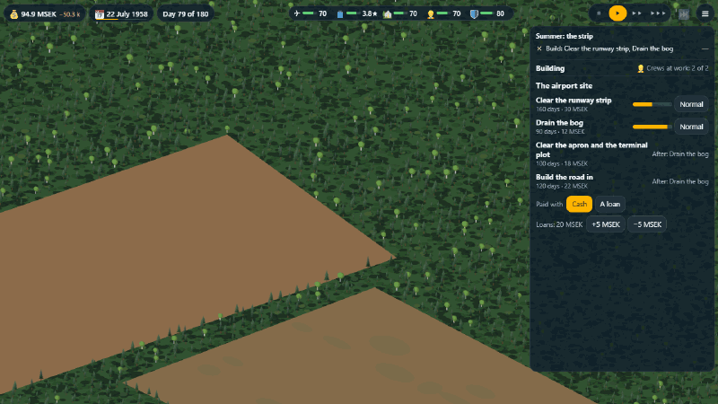
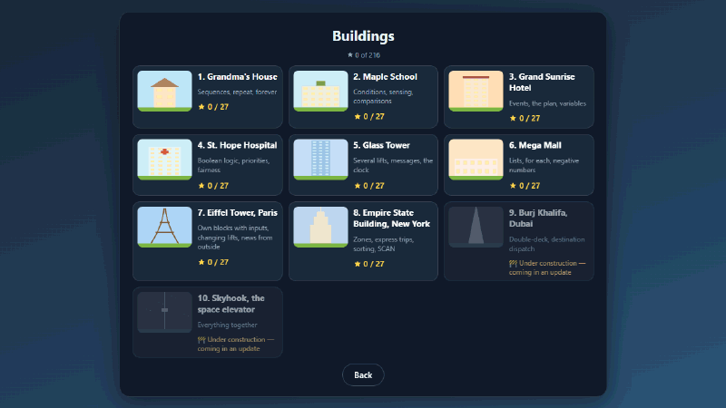
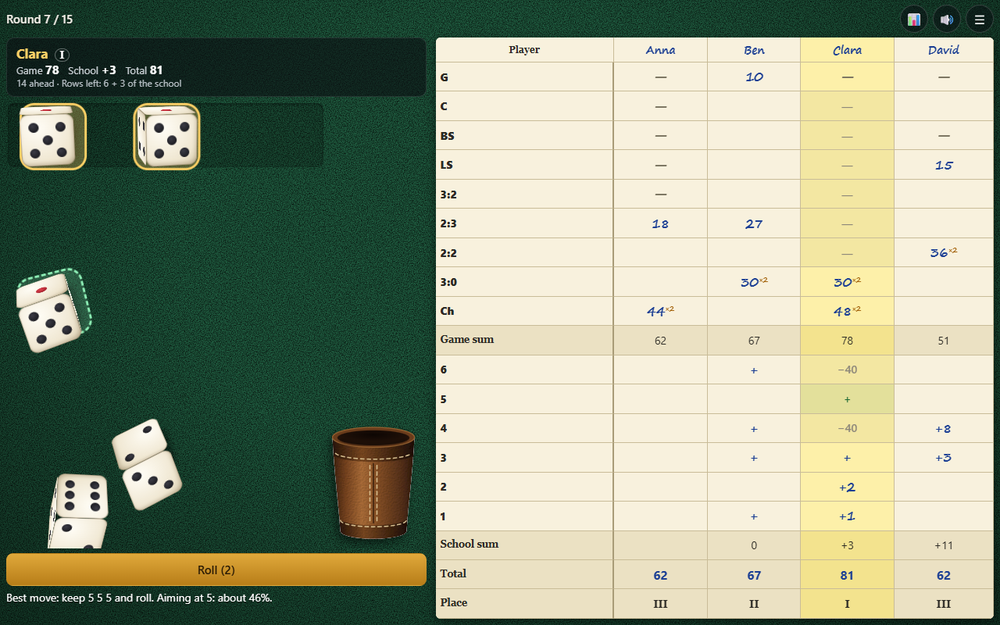
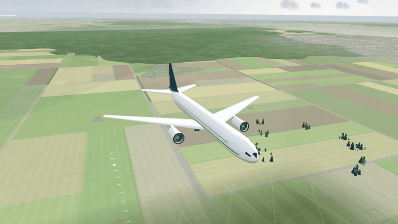
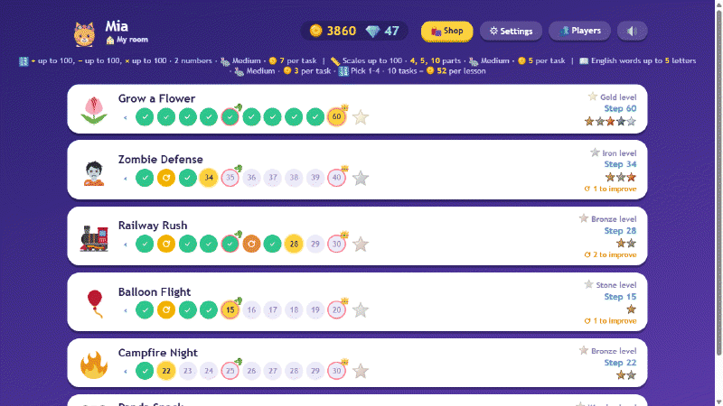
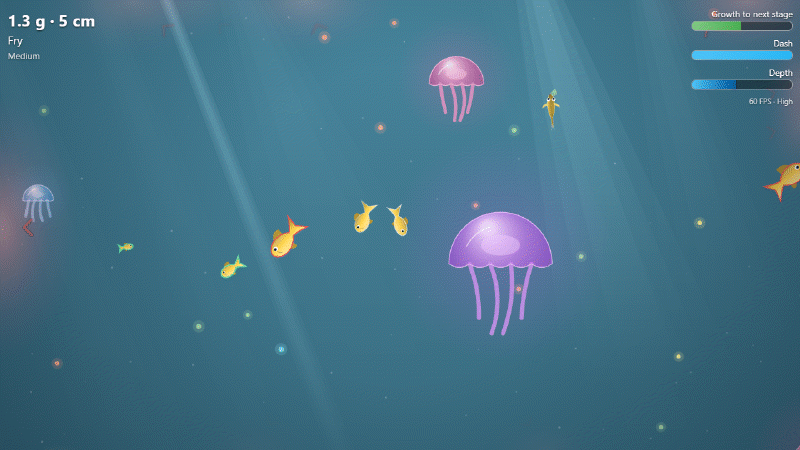
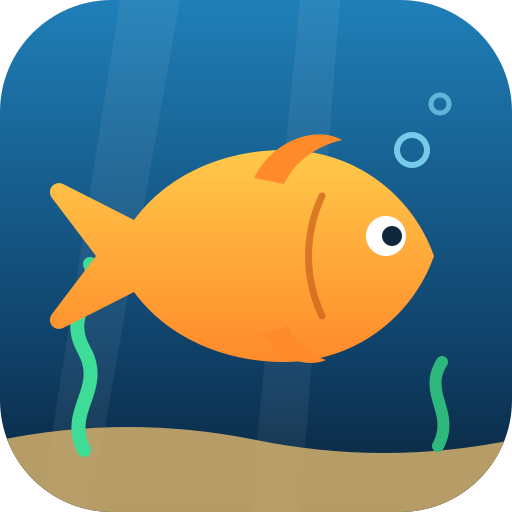

<div align="center">


# Browser Games Gallery

**Tiny self-contained browser games in vanilla JavaScript. No install — just open and play.**

[](https://gray0072.github.io/ivan/)


[](LICENSE)

*[Читать на русском](README_RU.md)* · *[Läs på svenska](README_SV.md)*

<a href="https://gray0072.github.io/ivan/"></a>

</div>

## 🎮 Games

<table>
  <tr>
    <td width="50%" valign="top">
      <a href="https://gray0072.github.io/ivan/arlanda-rising/"></a>
      <h3> Arlanda Rising</h3>
      <p>Run Stockholm Arlanda through its real history, from clearing the pine forest in 1958 through the jets, Schengen, the ash cloud and the pandemic to your own airport of 2040. An isometric airport that lives in front of you, short missions with stars, Free Play and a cloud save.</p>
      <p><code>Strategy</code> <code>Building</code> <code>Aviation</code></p>
      <p><a href="https://gray0072.github.io/ivan/arlanda-rising/"><b>▶ Play</b></a> · <a href="arlanda-rising/">Source</a> · <sub>2026-11-20</sub></p>
    </td>
    <td width="50%" valign="top">
      <a href="https://gray0072.github.io/ivan/lift-logic/"></a>
      <h3> Lift Logic</h3>
      <p>A programming puzzle: be the brain of a lift. Build its program from colourful blocks, Scratch-style, and watch a building live by it — from Grandma's house to a hotel, a hospital, the Eiffel Tower and the Empire State Building. 72 missions with stars, hints and jokes.</p>
      <p><code>Puzzle</code> <code>Learning</code> <code>For kids</code></p>
      <p><a href="https://gray0072.github.io/ivan/lift-logic/"><b>▶ Play</b></a> · <a href="lift-logic/">Source</a> · <sub>2026-11-19</sub></p>
    </td>
  </tr>
  <tr>
    <td width="50%" valign="top">
      <a href="https://gray0072.github.io/ivan/wiggle-wars/"></a>
      <h3> Wiggle Wars</h3>
      <p>Turn-based artillery with worms: bazookas, grenades, air strikes, a jetpack and more on a land that blows apart, with wind, crates and mines. One against one on one phone, against the computer, or a twelve-mission campaign with stars.</p>
      <p><code>Turn-based</code> <code>Multiplayer</code> <code>Shooter</code></p>
      <p><a href="https://gray0072.github.io/ivan/wiggle-wars/"><b>▶ Play</b></a> · <a href="wiggle-wars/">Source</a> · <sub>2026-11-10</sub></p>
    </td>
    <td width="50%" valign="top">
      <a href="https://gray0072.github.io/ivan/yacht/"></a>
      <h3> Yacht</h3>
      <p>The dice game Yacht, also known as Yahtzee and dice poker, for up to 10 players on one device: shake the leather cup, keep the dice you like and fill the score sheet. Saved groups of players, statistics, hints and a table of your choice.</p>
      <p><code>Tabletop</code> <code>Multiplayer</code> <code>Turn-based</code></p>
      <p><a href="https://gray0072.github.io/ivan/yacht/"><b>▶ Play</b></a> · <a href="yacht/">Source</a> · <sub>2026-11-03</sub></p>
    </td>
  </tr>
  <tr>
    <td width="50%" valign="top">
      <a href="https://gray0072.github.io/ivan/city-builder/"></a>
      <h3> City Builder</h3>
      <p>A city-building game: lay roads, build houses, shops and factories, keep the residents happy and watch cottages grow into apartment blocks. Grow a hamlet into a Metropolis, put out fires, hold back spring floods and don't go bankrupt.</p>
      <p><code>Strategy</code> <code>Building</code></p>
      <p><a href="https://gray0072.github.io/ivan/city-builder/"><b>▶ Play</b></a> · <a href="city-builder/">Source</a> · <sub>2026-10-24</sub></p>
    </td>
    <td width="50%" valign="top">
      <a href="https://gray0072.github.io/ivan/world-aviation/"></a>
      <h3> World Aviation</h3>
      <p>A cockpit-view flight simulator and airline career: start with Swedish domestic flights out of Arlanda, then buy traffic rights to the rest of the world. Push back, taxi, fly the ILS and land eighteen aircraft, from a 19-seat turboprop to the A380, at 141 real airports.</p>
      <p><code>Aviation</code> <code>Simulator</code> <code>Strategy</code></p>
      <p><a href="https://gray0072.github.io/ivan/world-aviation/"><b>▶ Play</b></a> · <a href="world-aviation/">Source</a> · <sub>2026-10-04</sub></p>
    </td>
  </tr>
  <tr>
    <td width="50%" valign="top">
      <a href="https://gray0072.github.io/ivan/fun-training/"></a>
      <h3> Fun Training</h3>
      <p>A training game for school kids: answer math and reading tasks in time to water a flower, stop zombies, lay rails for a train or keep a panda fed. Progress tracks with stars and bosses, and coins to spend on your own character and room.</p>
      <p><code>Learning</code> <code>For kids</code></p>
      <p><a href="https://gray0072.github.io/ivan/fun-training/"><b>▶ Play</b></a> · <a href="fun-training/">Source</a> · <sub>2026-09-28</sub></p>
    </td>
    <td width="50%" valign="top">
      <a href="https://gray0072.github.io/ivan/fish-frenzy/"></a>
      <h3> Fish Frenzy</h3>
      <p>Eat-and-grow arcade: steer a fish with the arrow keys or a touch joystick, eat plankton and smaller fish, dodge bigger ones and jellyfish, and climb the food chain to the Sea King. Three difficulty levels and best-time records.</p>
      <p><code>Arcade</code> <code>For kids</code></p>
      <p><a href="https://gray0072.github.io/ivan/fish-frenzy/"><b>▶ Play</b></a> · <a href="fish-frenzy/">Source</a> · <sub>2026-09-17</sub></p>
    </td>
  </tr>
  <tr>
    <td width="50%" valign="top">
      <a href="https://gray0072.github.io/ivan/flight-simulator/"></a>
      <h3> Flight Simulator</h3>
      <p>First-person arcade flight: steer with the arrow keys, pop balloons with the twin gun for points and land on the highlighted airport's runway.</p>
      <p><code>Aviation</code> <code>Arcade</code> <code>Shooter</code></p>
      <p><a href="https://gray0072.github.io/ivan/flight-simulator/"><b>▶ Play</b></a> · <a href="flight-simulator/">Source</a> · <sub>2026-09-05</sub></p>
    </td>
    <td width="50%" valign="top"></td>
  </tr>
</table>

## ✨ Highlights

- **Zero install** — runs straight in the browser on desktop and mobile, and installs to the home screen as an app that also works offline.
- **Touch controls** — on-screen joysticks and buttons on phones and tablets, keyboard and mouse on desktop.
- **Pure web platform** — Canvas 2D and WebGL for graphics, Web Audio for synthesized sound. No frameworks, no build step.
- **Self-contained** — each game lives in its own folder and still works when copied out of the repo.

## 🛠️ For developers

<details>
<summary><b>Run locally</b></summary>

```bash
git clone https://github.com/gray0072/ivan.git
cd ivan
npx serve .        # or just open any index.html in a browser
```

</details>

<details>
<summary><b>Deploy</b></summary>

There is no build step. GitHub Pages serves the `main` branch root directly
(**Settings → Pages → Deploy from a branch → `main` / `(root)`**), so pushing to `main` is the whole deploy.

</details>

<details>
<summary><b>Project structure</b></summary>

```
/
├── index.html, manifest.webmanifest   # the gallery page (an installable PWA)
├── assets/                  # gallery styles and scripts, icons, flags, showcase.gif, social preview
├── tools/                   # cdp.js (headless Chrome), i18n-check.js, pwa-icons.sh, sw-build.js, readme-games.js
├── README.md / README_RU.md / README_SV.md
├── SPEC.md                  # repo-wide spec and conventions
├── AGENTS.md                # instructions for AI coding agents (CLAUDE.md points here)
├── docs/                    # the agents' rules by area: languages, mobile, PWA and offline, icons, code layout, new project, cloud save, testing
└── <game>/                  # one folder per game: world-aviation, fish-frenzy, fun-training, flight-simulator, city-builder, yacht, wiggle-wars, lift-logic, arlanda-rising
    ├── SPEC.md              # spec of this game
    ├── index.html, styles.css, constants.js, game.js
    ├── core/, data/, sim/, render/, ui/, …   # the code, by role
    ├── README.md / README_RU.md (/ README_SV.md)
    ├── icon.svg, manifest.webmanifest, sw.js (offline), PWA icons
    └── screenshot.png
```

</details>

<details>
<summary><b>Roadmap</b></summary>

- [ ] More mini-games and experiments
- [x] Filter by tag on the gallery page
- [x] System, light and dark themes on the gallery page

</details>

## 📄 License

[MIT](LICENSE)

Emoji drawings: [Twemoji](https://github.com/jdecked/twemoji), © Twitter, Inc and other contributors, [CC-BY 4.0](https://creativecommons.org/licenses/by/4.0/).
