<div align="center">


# Галерея браузерных игр

**Маленькие самостоятельные браузерные игры на чистом JavaScript. Ничего не нужно устанавливать — просто открой и играй.**

[](https://gray0072.github.io/ivan/)


[](LICENSE)

*[Read in English](README.md)* · *[Läs på svenska](README_SV.md)*

<a href="https://gray0072.github.io/ivan/">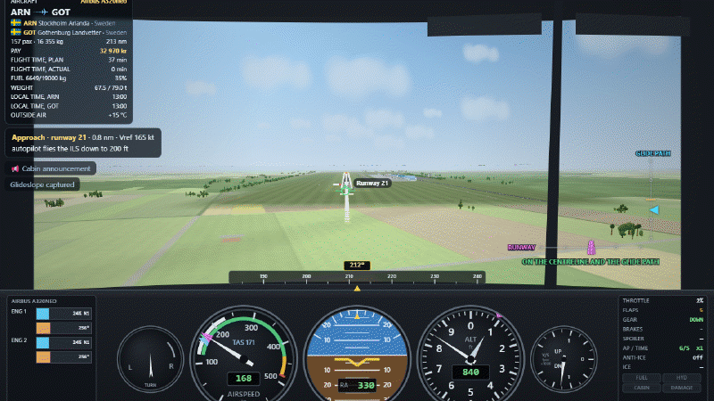</a>

</div>

## 🎮 Игры

<table>
  <tr>
    <td width="50%" valign="top">
      <a href="https://gray0072.github.io/ivan/world-aviation/">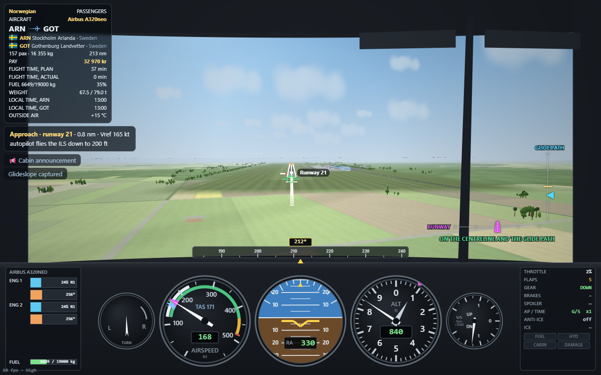</a>
      <h3> World Aviation</h3>
      <p>Авиасимулятор с видом из кабины и карьера пилота: от шведских внутренних рейсов из Арланды до всего мира. Буксировка, руление, заход по ILS, посадка и стоянка у гейта.</p>
      <p><a href="https://gray0072.github.io/ivan/world-aviation/"><b>▶ Играть</b></a> · <a href="world-aviation/">Исходники</a></p>
    </td>
    <td width="50%" valign="top">
      <a href="https://gray0072.github.io/ivan/fish-frenzy/">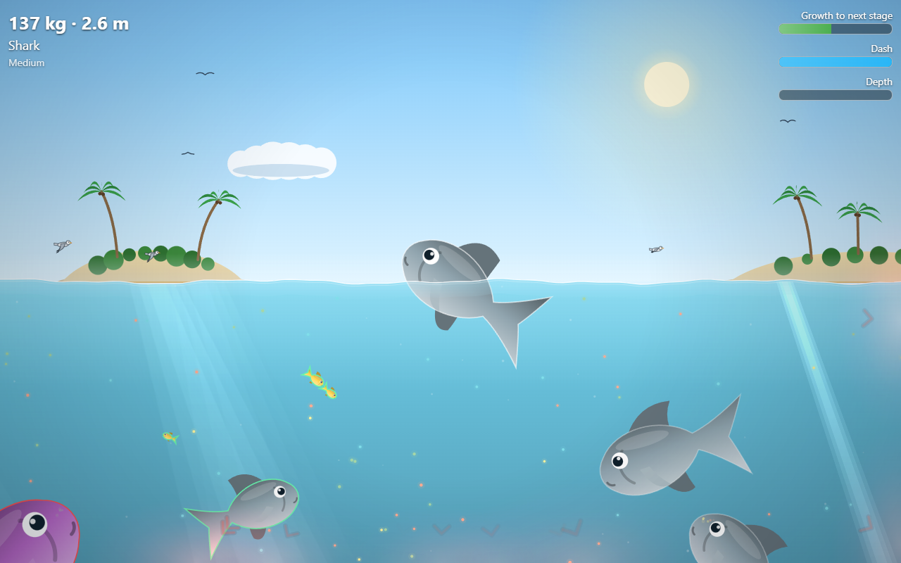</a>
      <h3>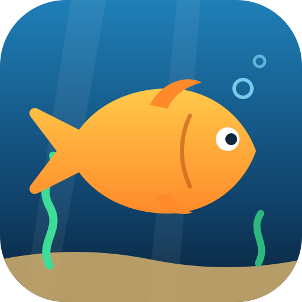 Fish Frenzy</h3>
      <p>Аркада «съешь и расти»: ешь планктон и рыб мельче себя, уворачивайся от крупных рыб и медуз и поднимайся по пищевой цепи до Морского Царя.</p>
      <p><a href="https://gray0072.github.io/ivan/fish-frenzy/"><b>▶ Играть</b></a> · <a href="fish-frenzy/">Исходники</a></p>
    </td>
  </tr>
  <tr>
    <td width="50%" valign="top">
      <a href="https://gray0072.github.io/ivan/fun-training/">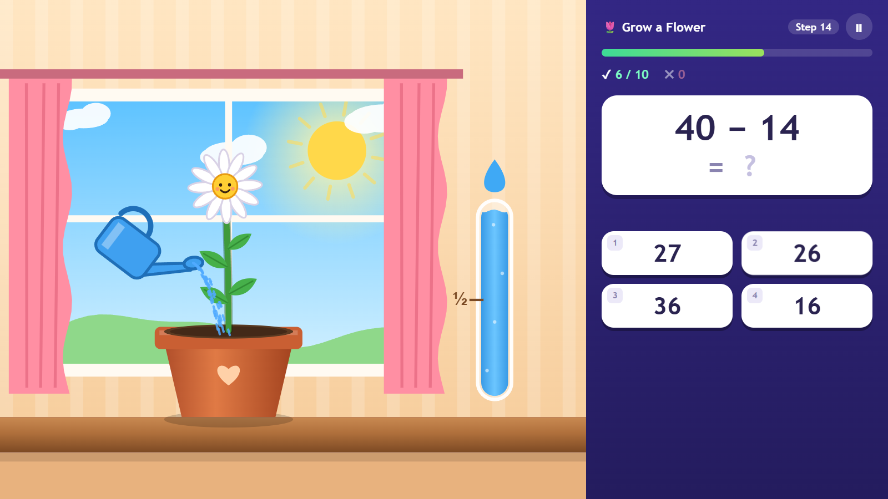</a>
      <h3> Fun Training</h3>
      <p>Игра-тренажёр для школьников: успевай отвечать на задания, чтобы полить цветок, остановить зомби или накормить панду, а на монеты наряжай своего персонажа.</p>
      <p><a href="https://gray0072.github.io/ivan/fun-training/"><b>▶ Играть</b></a> · <a href="fun-training/">Исходники</a></p>
    </td>
    <td width="50%" valign="top">
      <a href="https://gray0072.github.io/ivan/flight-simulator/">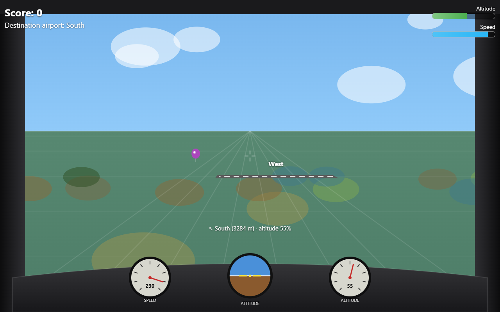</a>
      <h3> Flight Simulator</h3>
      <p>Аркадный полёт от первого лица: сбивай воздушные шарики из спаренной пушки и садись на полосу отмеченного аэропорта.</p>
      <p><a href="https://gray0072.github.io/ivan/flight-simulator/"><b>▶ Играть</b></a> · <a href="flight-simulator/">Исходники</a></p>
    </td>
  </tr>
  <tr>
    <td width="50%" valign="top">
      <a href="https://gray0072.github.io/ivan/city-builder/">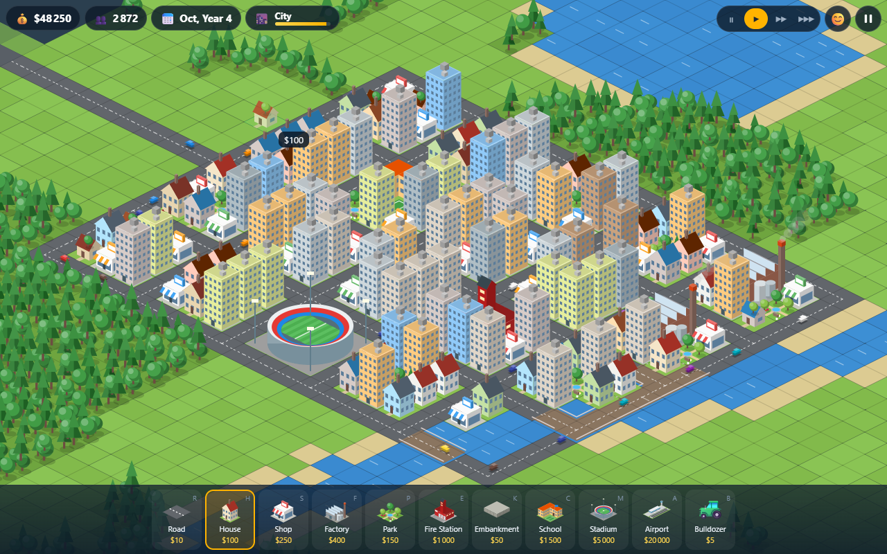</a>
      <h3>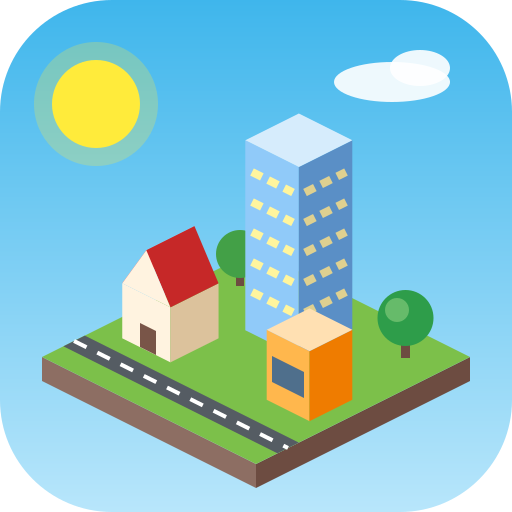 City Builder</h3>
      <p>Градостроитель: прокладывай дороги, строй дома, магазины и фабрики, заботься о жителях и преврати хутор в мегаполис — берегись пожаров и весенних наводнений.</p>
      <p><a href="https://gray0072.github.io/ivan/city-builder/"><b>▶ Играть</b></a> · <a href="city-builder/">Исходники</a></p>
    </td>
    <td width="50%" valign="top">
      <a href="https://gray0072.github.io/ivan/yacht/">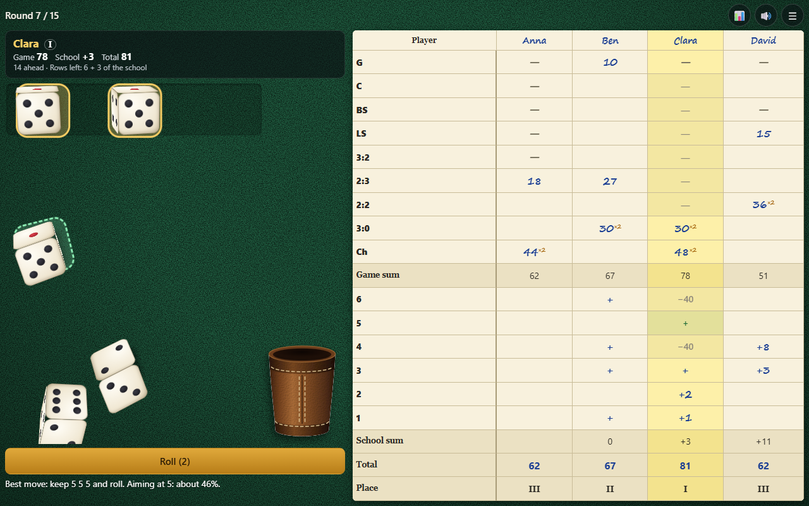</a>
      <h3> Яхт</h3>
      <p>Яхт, он же Yahtzee и покер на костях, для компании до 10 игроков на одном устройстве: кожаный стакан, сохранённые группы игроков, статистика и стол на выбор.</p>
      <p><a href="https://gray0072.github.io/ivan/yacht/"><b>▶ Играть</b></a> · <a href="yacht/">Исходники</a></p>
    </td>
  </tr>
  <tr>
    <td width="50%" valign="top">
      <a href="https://gray0072.github.io/ivan/wiggle-wars/"></a>
      <h3> Wiggle Wars</h3>
      <p>Пошаговая артиллерия с червяками: базуки, гранаты, авиаудары и ящики на разрушаемой земле — один на один на одном телефоне, против компьютера или кампания из двенадцати миссий.</p>
      <p><a href="https://gray0072.github.io/ivan/wiggle-wars/"><b>▶ Играть</b></a> · <a href="wiggle-wars/">Исходники</a></p>
    </td>
    <td width="50%" valign="top">
      <a href="https://gray0072.github.io/ivan/lift-logic/">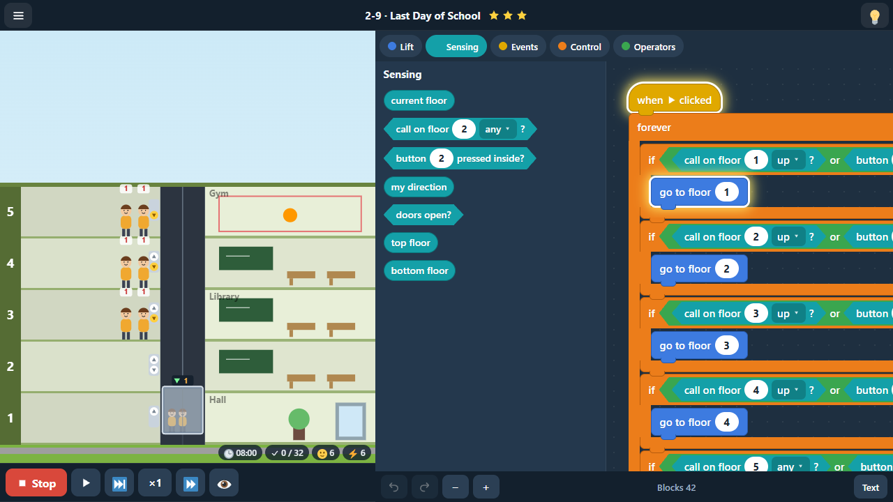</a>
      <h3> Lift Logic</h3>
      <p>Стань мозгом лифта: собери его программу из блоков и смотри, как по ней живёт дом, — от бабушкиного дома до школы, отеля, больницы, офисной башни, торгового центра, Эйфелевой башни и Эмпайр-стейт-билдинг, 72 задания со звёздами, подсказками и шутками.</p>
      <p><a href="https://gray0072.github.io/ivan/lift-logic/"><b>▶ Играть</b></a> · <a href="lift-logic/">Исходники</a></p>
    </td>
  </tr>
  <tr>
    <td width="50%" valign="top">
      <a href="https://gray0072.github.io/ivan/arlanda-rising/">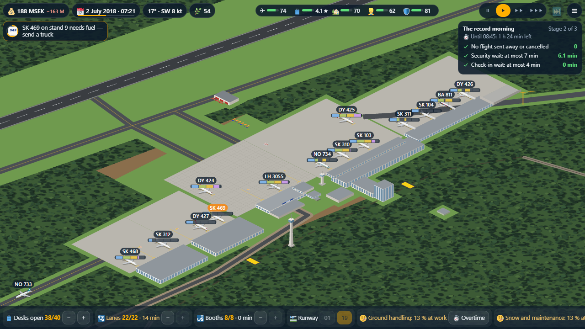</a>
      <h3> Arlanda Rising</h3>
      <p>Управляй стокгольмской Арландой по её настоящей истории: расчисти лес в 1958 году, ставь самолёты на стоянки и чисти снег вручную, а потом расти с реактивной эрой и передавай работу командам, руководителям и первым компьютерам — изометрический аэропорт, короткие миссии со звёздами, которые всё время сохраняются, свободная игра и облачное сохранение.</p>
      <p><a href="https://gray0072.github.io/ivan/arlanda-rising/"><b>▶ Играть</b></a> · <a href="arlanda-rising/">Исходники</a></p>
    </td>
    <td width="50%" valign="top"></td>
  </tr>
</table>

## ✨ Особенности

- **Без установки** — игры запускаются прямо в браузере, на компьютере и на телефоне, и ставятся на главный экран как приложение, которое работает и без интернета.
- **Сенсорное управление** — экранные джойстики и кнопки на телефонах и планшетах, клавиатура и мышь на компьютере.
- **Только веб-платформа** — Canvas 2D и WebGL для графики, Web Audio для синтезированного звука. Без фреймворков и сборки.
- **Самостоятельные проекты** — каждая игра живёт в своей папке и работает, даже если скопировать её из репозитория.

## 🛠️ Разработчикам

<details>
<summary><b>Запуск локально</b></summary>

```bash
git clone https://github.com/gray0072/ivan.git
cd ivan
npx serve .        # или просто открой любой index.html в браузере
```

</details>

<details>
<summary><b>Деплой</b></summary>

Сборки нет. GitHub Pages отдаёт файлы прямо из корня ветки `main`
(**Settings → Pages → Deploy from a branch → `main` / `(root)`**), так что пуш в `main` — это и есть весь деплой.

</details>

<details>
<summary><b>Структура проекта</b></summary>

```
/
├── index.html, manifest.webmanifest   # страница-галерея (устанавливается как PWA)
├── assets/                  # стили и скрипты галереи, иконки, флаги, showcase.gif, картинка для соцсетей
├── tools/                   # cdp.js (headless Chrome), i18n-check.js, pwa-icons.sh, sw-build.js
├── README.md / README_RU.md / README_SV.md
├── SPEC.md                  # спецификация и правила всего репозитория
├── AGENTS.md                # инструкции для AI-агентов (CLAUDE.md ссылается сюда)
├── docs/                    # правила для агентов по областям: языки, мобильные, PWA и офлайн, значки, структура кода, новый проект, облачное сохранение, тесты
└── <игра>/                  # по папке на игру: world-aviation, fish-frenzy, fun-training, flight-simulator, city-builder, yacht, wiggle-wars, lift-logic, arlanda-rising
    ├── SPEC.md              # спецификация этой игры
    ├── index.html, styles.css, constants.js, game.js
    ├── core/, data/, sim/, render/, ui/, …   # код, разложенный по ролям
    ├── README.md / README_RU.md (/ README_SV.md)
    ├── icon.svg, manifest.webmanifest, sw.js (офлайн), иконки PWA
    └── screenshot.png
```

</details>

<details>
<summary><b>Планы</b></summary>

- [ ] Больше мини-игр и экспериментов
- [ ] Поиск/фильтр на странице галереи
- [ ] Переключатель светлой/тёмной темы на странице галереи

</details>

## 📄 Лицензия

[MIT](LICENSE)

Рисунки эмодзи: [Twemoji](https://github.com/jdecked/twemoji), © Twitter, Inc и другие участники, [CC-BY 4.0](https://creativecommons.org/licenses/by/4.0/).
