<div align="center">


# Galleri med webbläsarspel

**Små fristående webbläsarspel i ren JavaScript. Ingen installation — öppna bara och spela.**

[](https://gray0072.github.io/ivan/)


[](LICENSE)

*[Read in English](README.md)* · *[Читать на русском](README_RU.md)*

<a href="https://gray0072.github.io/ivan/">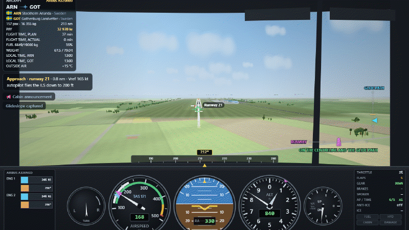</a>

</div>

## 🎮 Spel

<table>
  <tr>
    <td width="50%" valign="top">
      <a href="https://gray0072.github.io/ivan/arlanda-rising/">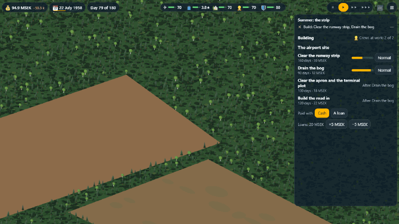</a>
      <h3> Arlanda Rising</h3>
      <p>Driv Stockholm Arlanda genom dess riktiga historia: från tallskogen som röjs 1958 via jetplanen, Schengen, askmolnet och pandemin till ditt eget Arlanda 2040. En isometrisk flygplats som lever framför dig, korta uppdrag med stjärnor, fritt spel och molnsparning.</p>
      <p><code>Strategi</code> <code>Bygga</code> <code>Flyg</code></p>
      <p><a href="https://gray0072.github.io/ivan/arlanda-rising/"><b>▶ Spela</b></a> · <a href="arlanda-rising/">Källkod</a> · <sub>2026-11-20</sub></p>
    </td>
    <td width="50%" valign="top">
      <a href="https://gray0072.github.io/ivan/lift-logic/">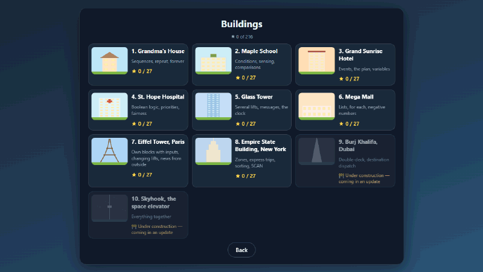</a>
      <h3>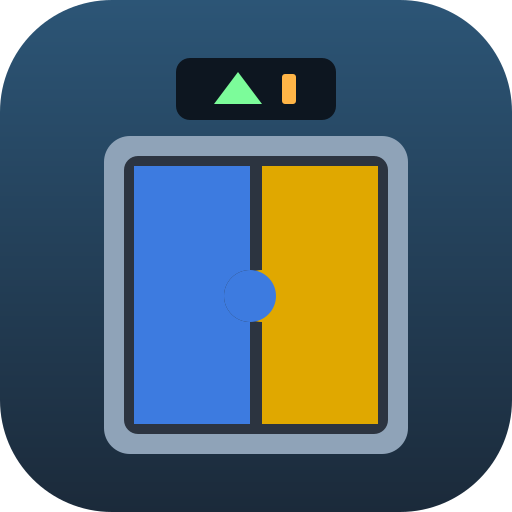 Lift Logic</h3>
      <p>Ett programmeringspussel: var hissens hjärna. Bygg dess program av färgglada block, som i Scratch, och se ett hus leva efter det — från mormors hus till ett hotell, ett sjukhus, Eiffeltornet och Empire State Building. 72 uppdrag med stjärnor, tips och skämt.</p>
      <p><code>Pussel</code> <code>Lärande</code> <code>För barn</code></p>
      <p><a href="https://gray0072.github.io/ivan/lift-logic/"><b>▶ Spela</b></a> · <a href="lift-logic/">Källkod</a> · <sub>2026-11-19</sub></p>
    </td>
  </tr>
  <tr>
    <td width="50%" valign="top">
      <a href="https://gray0072.github.io/ivan/wiggle-wars/"></a>
      <h3> Wiggle Wars</h3>
      <p>Turbaserat artilleri med maskar: bazookor, granater, flyganfall, raketryggsäck och mer på en mark som sprängs i bitar, med vind, lådor och minor. En mot en på en telefon, mot datorn eller en kampanj med tolv uppdrag och stjärnor.</p>
      <p><code>Turbaserat</code> <code>Flera spelare</code> <code>Skjutspel</code></p>
      <p><a href="https://gray0072.github.io/ivan/wiggle-wars/"><b>▶ Spela</b></a> · <a href="wiggle-wars/">Källkod</a> · <sub>2026-11-10</sub></p>
    </td>
    <td width="50%" valign="top">
      <a href="https://gray0072.github.io/ivan/yacht/">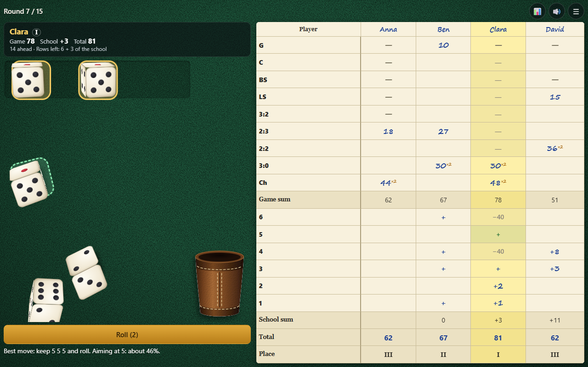</a>
      <h3>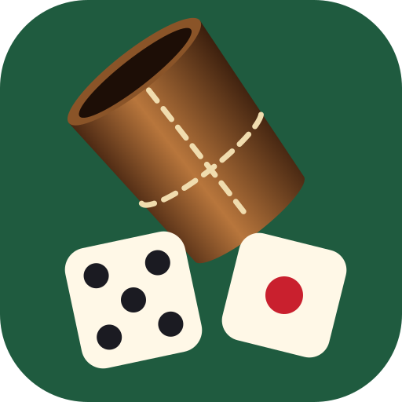 Yacht</h3>
      <p>Tärningsspelet Yacht, även känt som Yatzy och tärningspoker, för upp till 10 spelare på en enhet: skaka läderbägaren, behåll de tärningar du vill ha och fyll i protokollet. Sparade spelargrupper, statistik, tips och ett bord efter eget val.</p>
      <p><code>Sällskapsspel</code> <code>Flera spelare</code> <code>Turbaserat</code></p>
      <p><a href="https://gray0072.github.io/ivan/yacht/"><b>▶ Spela</b></a> · <a href="yacht/">Källkod</a> · <sub>2026-11-03</sub></p>
    </td>
  </tr>
  <tr>
    <td width="50%" valign="top">
      <a href="https://gray0072.github.io/ivan/city-builder/">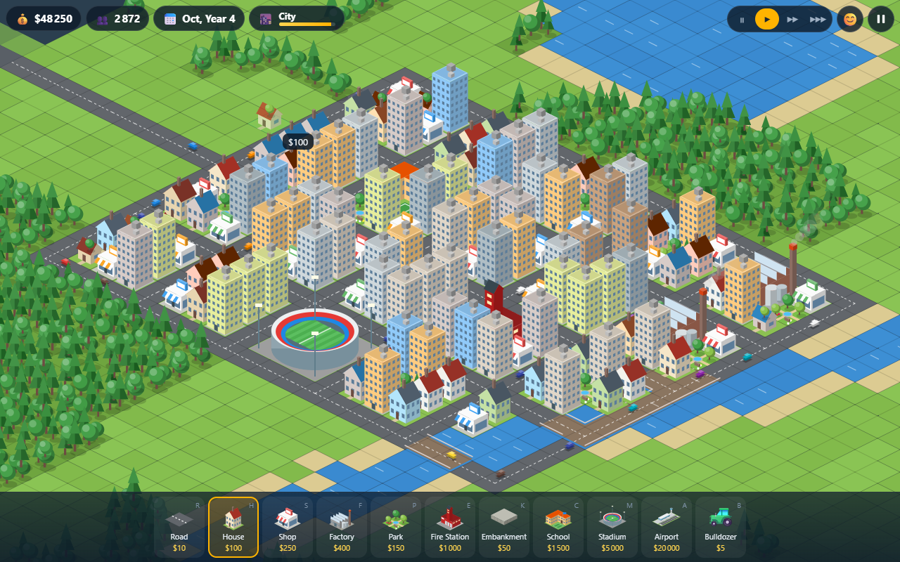</a>
      <h3>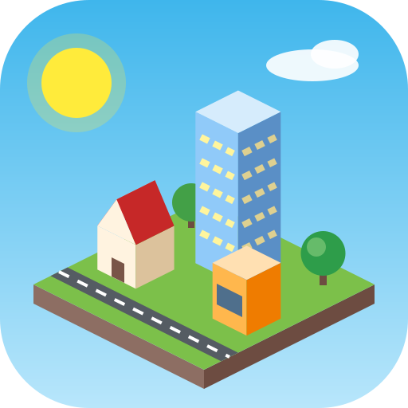 City Builder</h3>
      <p>Ett stadsbyggarspel: bygg vägar, hus, affärer och fabriker, håll invånarna glada och se stugorna växa till höghus. Låt ett torp bli en Metropol, släck bränder, stoppa vårfloden och gå inte i konkurs.</p>
      <p><code>Strategi</code> <code>Bygga</code></p>
      <p><a href="https://gray0072.github.io/ivan/city-builder/"><b>▶ Spela</b></a> · <a href="city-builder/">Källkod</a> · <sub>2026-10-24</sub></p>
    </td>
    <td width="50%" valign="top">
      <a href="https://gray0072.github.io/ivan/world-aviation/">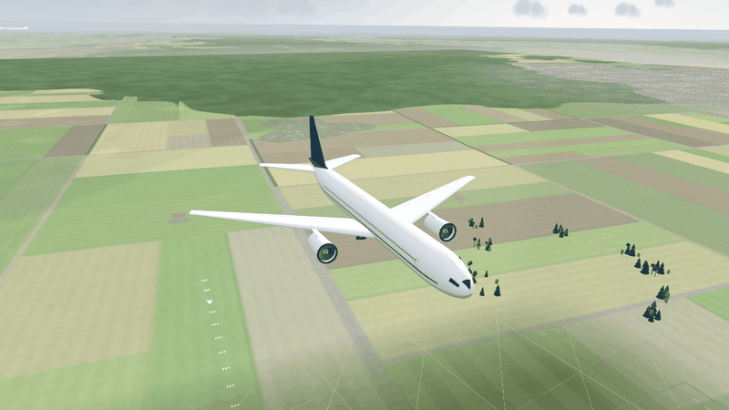</a>
      <h3> World Aviation</h3>
      <p>En flygsimulator med vy från cockpit och en karriär i ett flygbolag: börja med inrikesflyg i Sverige från Arlanda och köp sedan trafikrättigheter till resten av världen. Pushback, taxning, ILS-inflygning och landning med arton flygplan, från en turboprop med 19 platser till A380, på 141 riktiga flygplatser.</p>
      <p><code>Flyg</code> <code>Simulator</code> <code>Strategi</code></p>
      <p><a href="https://gray0072.github.io/ivan/world-aviation/"><b>▶ Spela</b></a> · <a href="world-aviation/">Källkod</a> · <sub>2026-10-04</sub></p>
    </td>
  </tr>
  <tr>
    <td width="50%" valign="top">
      <a href="https://gray0072.github.io/ivan/fun-training/">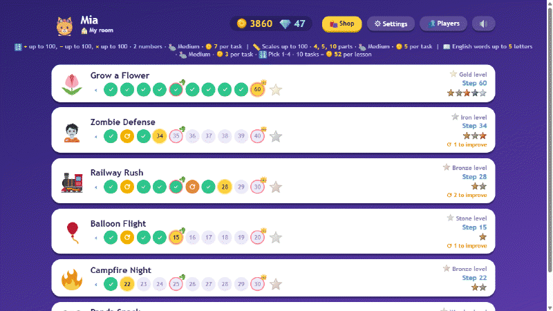</a>
      <h3> Fun Training</h3>
      <p>Ett övningsspel för skolbarn: lös matte- och läsuppgifter i tid för att vattna en blomma, stoppa zombier, lägga räls åt ett tåg eller hålla en panda mätt. Framstegsbanor med stjärnor och bossar, och mynt att lägga på din egen figur och ditt rum.</p>
      <p><code>Lärande</code> <code>För barn</code></p>
      <p><a href="https://gray0072.github.io/ivan/fun-training/"><b>▶ Spela</b></a> · <a href="fun-training/">Källkod</a> · <sub>2026-09-28</sub></p>
    </td>
    <td width="50%" valign="top">
      <a href="https://gray0072.github.io/ivan/fish-frenzy/">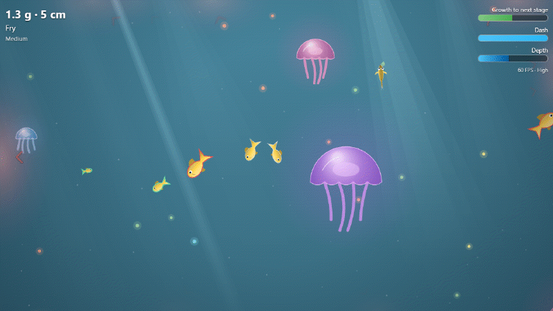</a>
      <h3>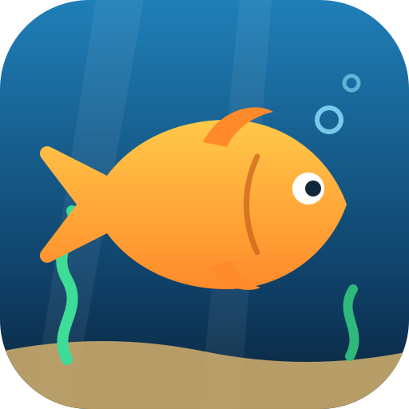 Fish Frenzy</h3>
      <p>Ett ät-och-väx-arkadspel: styr en fisk med piltangenterna eller en joystick på skärmen, ät plankton och mindre fiskar, undvik större fiskar och maneter och klättra uppför näringskedjan till Havskungen. Tre svårighetsgrader och rekord för bästa tid.</p>
      <p><code>Arkad</code> <code>För barn</code></p>
      <p><a href="https://gray0072.github.io/ivan/fish-frenzy/"><b>▶ Spela</b></a> · <a href="fish-frenzy/">Källkod</a> · <sub>2026-09-17</sub></p>
    </td>
  </tr>
  <tr>
    <td width="50%" valign="top">
      <a href="https://gray0072.github.io/ivan/flight-simulator/">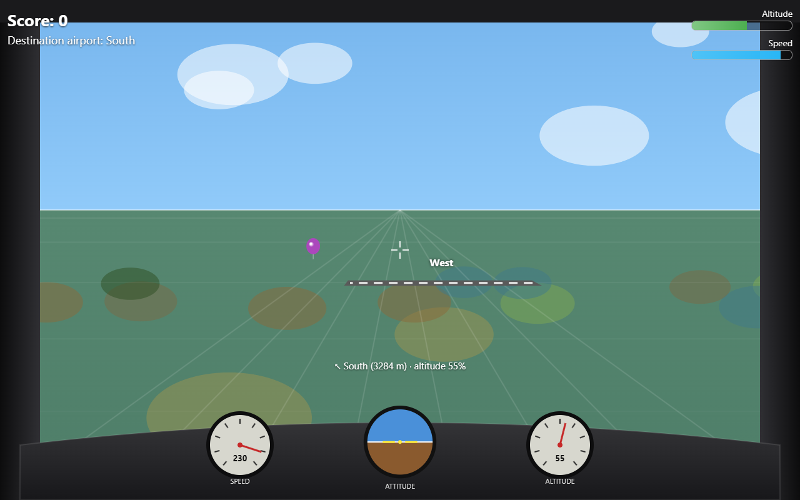</a>
      <h3> Flight Simulator</h3>
      <p>Arkadflyg i förstapersonsvy: styr med piltangenterna, skjut ballonger med dubbelkanonen för poäng och landa på banan vid den markerade flygplatsen.</p>
      <p><code>Flyg</code> <code>Arkad</code> <code>Skjutspel</code></p>
      <p><a href="https://gray0072.github.io/ivan/flight-simulator/"><b>▶ Spela</b></a> · <a href="flight-simulator/">Källkod</a> · <sub>2026-09-05</sub></p>
    </td>
    <td width="50%" valign="top"></td>
  </tr>
</table>

## ✨ Det bästa

- **Ingen installation** — spelen körs direkt i webbläsaren, på datorn och i mobilen, och kan läggas på hemskärmen som en app som fungerar även utan internet.
- **Pekskärmsstyrning** — joystickar och knappar på skärmen i telefoner och surfplattor, tangentbord och mus på datorn.
- **Ren webbplattform** — Canvas 2D och WebGL för grafiken, Web Audio för syntetiserat ljud. Inga ramverk, inget byggsteg.
- **Fristående** — varje spel ligger i sin egen mapp och fungerar även om det kopieras ut ur repot.

## 🛠️ För utvecklare

<details>
<summary><b>Kör lokalt</b></summary>

```bash
git clone https://github.com/gray0072/ivan.git
cd ivan
npx serve .        # eller öppna bara valfri index.html i en webbläsare
```

</details>

<details>
<summary><b>Publicering</b></summary>

Det finns inget byggsteg. GitHub Pages serverar roten av grenen `main` direkt
(**Settings → Pages → Deploy from a branch → `main` / `(root)`**), så en push till `main` är hela publiceringen.

</details>

<details>
<summary><b>Projektets struktur</b></summary>

```
/
├── index.html, manifest.webmanifest   # gallerisidan (installerbar som PWA)
├── assets/                  # galleriets stilar och skript, ikoner, flaggor, showcase.gif, bild för sociala medier
├── tools/                   # cdp.js (headless Chrome), i18n-check.js, pwa-icons.sh, sw-build.js, readme-games.js
├── README.md / README_RU.md / README_SV.md
├── SPEC.md                  # specifikation och regler för hela repot
├── AGENTS.md                # instruktioner för AI-agenter (CLAUDE.md pekar hit)
├── docs/                    # agenternas regler per område: språk, mobil, PWA och offline, ikoner, kodstruktur, nytt projekt, molnsparning, tester
└── <spel>/                  # en mapp per spel: world-aviation, fish-frenzy, fun-training, flight-simulator, city-builder, yacht, wiggle-wars, lift-logic, arlanda-rising
    ├── SPEC.md              # spelets specifikation
    ├── index.html, styles.css, constants.js, game.js
    ├── core/, data/, sim/, render/, ui/, …   # koden, ordnad efter roll
    ├── README.md / README_RU.md (/ README_SV.md)
    ├── icon.svg, manifest.webmanifest, sw.js (offline), PWA-ikoner
    └── screenshot.png
```

</details>

<details>
<summary><b>Planer</b></summary>

- [ ] Fler minispel och experiment
- [x] Filter efter taggar på gallerisidan
- [x] Systemets, ljust och mörkt tema på gallerisidan

</details>

## 📄 Licens

[MIT](LICENSE)

Emojibilder: [Twemoji](https://github.com/jdecked/twemoji), © Twitter, Inc och andra bidragsgivare, [CC-BY 4.0](https://creativecommons.org/licenses/by/4.0/).
