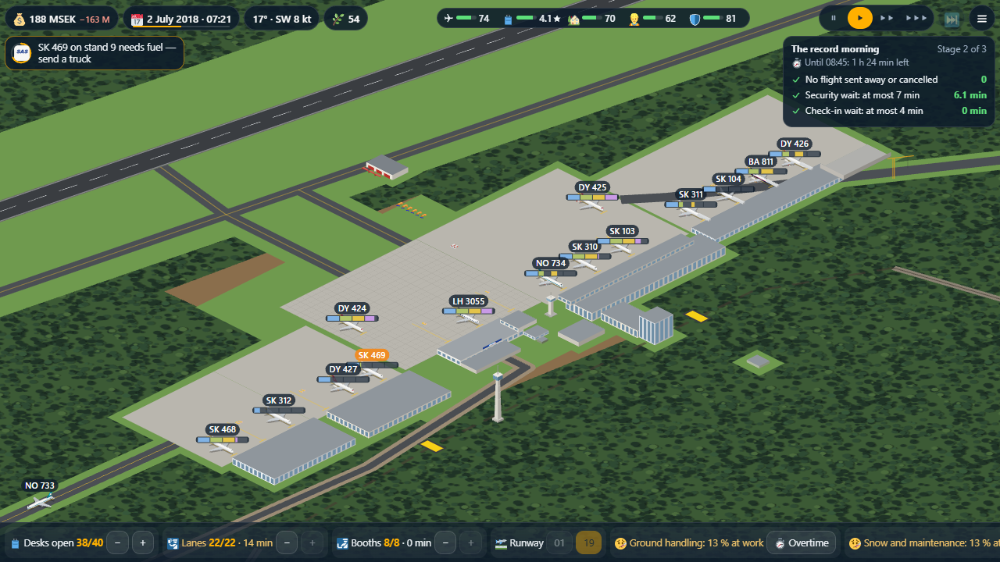

# Arlanda Rising

*[Читать на русском](README_RU.md)* · *[Läs på svenska](README_SV.md)*

A management game about running a real airport, **Stockholm Arlanda**, told through its real history. You are the director: in the pine forest north of Stockholm in 1958 you clear the site, then you build the control tower and the first terminal, pick a stand for every SAS Caravelle and DC-8, open check-in desks, fuel the jets, plough the snow on dark winter afternoons, light the runway and make the young airport pay. Then the jet age comes — the jumbo, runway 2 for the crosswinds, the international terminal of 1976, the domestic flights moving in from Bromma in 1983 — and the work grows too big for your hands: you hire teams and their managers, put in the first computers, and learn that machines break and unions strike.

The airport is drawn in isometric view and lives in front of you: aircraft in their airline's colours land, taxi, turn round at their stands with stairs, catering, baggage carts and fuel trucks, and take off again; plough convoys sweep the runway with amber beacons; the sun follows the real latitude, so December afternoons are dark and summer nights are bright.

Three chapters are ready — **The Forest Field** (1958–1963), **The Jet Age** (1965–1976) and **Everyone Comes to Arlanda** (1983–1989): 33 missions of about 4–9 minutes each (an exam about 10), split into stages and saved all the time, and **Free Play** after chapter 2. The next chapters — Arlanda Express, runway 3, the ash cloud, the pandemic and an Arlanda of 2040 that you design — come in later versions.

Playable in English, Russian or Swedish: pick the language at the top of the start screen.

*A free, non-commercial fan game; not affiliated with or endorsed by Swedavia or any company shown. Names and logos belong to their owners.*

## How to run

Open [index.html](index.html) in a browser. There is no build step and no server is needed.

## How to play

- **New Campaign** starts in May 1958; **Continue** opens the campaign's timeline with every mission and its stars. A mission card has Astrid's briefing, the goal, the two goals for more stars, the stages and what is new.
- **Build stages** (a day passes every second): start the jobs in the panel on the right — each takes days and money, and only as many run at once as you have crews. Pick a normal or a fast pace, buy options like heated winter tents, pay with cash or a loan. A choice (sell the timber or burn it? a café or a kiosk?) stops the time until you pick.
- **Operations stages** (an hour takes about a minute): the **task tray** on the left fills with jobs — "SK 104 lands in 4 min — pick a stand", "Check-in queue 12 min — open a desk", "SK 908 needs fuel — send a truck", "Snow on the runway — send the ploughs". Tap a task to do the obvious thing, or drag a landing aircraft onto a stand of your choice (**Pick** lights up the stands that fit). A task you miss goes to the duty manager, who does it late and not always well.
- The bar at the bottom opens and closes check-in desks, sends the ploughs, picks the runway direction when the wind is calm (01 lands over Märsta, 19 takes off over it — which spares the town at night?) and buys small things: a remote stand, a fuel truck, a snowplough.
- The HUD shows the money, the date and the clock, the weather, and the five meters: **Airlines**, **Passengers** (as stars), **Neighbours**, **Staff** and **Safety**. Tap an aircraft to see its card and its turnaround.
- After each stage a card shows how it went; after the mission you get up to three stars. Between missions the **Office** shows the money, the loans and the last months' books.

### Teams, managers and systems (from chapter 2)

- **Teams** take a whole kind of task off your hands — stand planners, a ramp supervisor, a desk scheduler, a snow team, baggage handlers, a PA operator — for wages every month. A new team needs two weeks before its first shift.
- **People are not machines:** some are away every day, many more in the flu season (January–February) and in July's holidays unless you spread them out. A team that is short sends part of its work back to your tray; **Overtime** in the bar below brings everybody in for a stage, at a price, and they are tired afterwards. Seasonal temps cover some gaps.
- **Managers** come in pairs, each with two strengths and a flaw (a snow chief who "smells snow" but bills overtime in every storm; an IT head who mends failures twice as fast but wants the newest system every year). They ask for raises and can be poached by Copenhagen, Oslo or Helsinki.
- **Unions** ask for higher wages every year or two: accept, offer less (the union's mood decides), ask the mediator — or refuse, and get a strike a week later. On strike days a team does a sixth of its work.
- **Systems** (from the 1970s and 80s: conveyor belts, a stand allocation computer, flight information screens, check-in computers, a weather-based clearing plan) work fast and right, but cost a licence every month, need IT people, and fail. A failed system hands its work to the team you kept beside it — or to you, if you laid it off. **Readiness** (how well the staff still know the manual way) fades every month without a drill. A power cut stops every system without backup power.
- New jobs on the airfield: **bags** (send the carts to every arrival — boarding waits for them), **announcements** (tell the passengers of a late flight), the **fire category** (an aircraft too big for your fire service is sent elsewhere), emergencies, fog with an instrument landing system, and crosswinds that close runway 1 while runway 2 stays open.
- In the Office, **People** (P) shows every team's morale, skill, fatigue, absence and wages, the unions and the managers' candidates; the **Ops Center** (O) shows every domain's level, uptime, monthly cost and readiness, and puts in the next level or holds a drill.

### Free Play

After chapter 2 the start screen offers **Free Play**: an endless airport from an era the campaign has opened (1963, 1976, 1990). Every round is a month of business — two offers from airlines, shops, managers, unions and suppliers — and a busy peak flown from your airlines' own routes, with no stars and no frame.

### Missions

**Chapter 1, The Forest Field:** Clear the Forest · First Wheels (14 December 1959, the first landing) · The Tower · The First Terminal (the first regular flight, an SAS DC-8 to New York on 26 June 1960) · The First Jets · The Fuel Truck · First Snow · Make It Pay · Night Lights · Opening Day (1 April 1962) · *Exam: The First Winter*.

**Chapter 2, The Jet Age:** Room for the Jets · Charter Summer · Hire a Hand · Two Managers · Jumbo! (SAS's first 747, 1971) · Fire Category · The Wage Round · The Bag Belt · Fog Morning · Crosswind (runway 2) · *Exam: The International Terminal* (1976).

**Chapter 3, Everyone Comes to Arlanda:** Linjeflyg Moves In (October 1983) · Morning Peak · The Computer Room · Screens · Flu Season · Strike Notice · The Big Freeze · Planner or Computer? · Payback · Flygbussarna (1989) · *Exam: Domestic Rush*.

## Never lost

A mission is saved every few seconds and the moment the page is hidden — a phone that locks, a time limit that closes the app. Open the game again and **Continue mission** goes on from that very moment, paused. A failed stage is retried, not the whole mission.

## Controls

**Phone and tablet:** the game goes fullscreen. Drag with one finger to move the map, pinch with two fingers to zoom. Tap a task, or drag it — or a landing aircraft — onto a stand. Hold a finger on an aircraft to see its card.

**Keyboard and mouse:** click and drag; the wheel zooms, right drag or the arrow keys move the map. **Space** pause / play, **1–4** the speed, **N** skip to the next task, **Q** do the oldest task, **P** People, **O** the Ops Center, **Esc** the pause menu. In the menus Space or Enter presses the highlighted button.

## Difficulty

Pick it on the start screen, on the mission card, in the pause menu or on the results screen; it is remembered. Stars are kept for each difficulty.

- **Easy:** 50 % more money, flights nearer their times, calmer weather, more patient airlines, task deadlines 50 % longer, fewer sick days and system failures, six months in debt before the owner steps in.
- **Medium:** the game as it is meant to be played.
- **Hard:** 25 % less money, flights early and late, harsher weather, impatient airlines, deadlines 25 % shorter, more sick days and failures, three months in debt.

## Sound

All sounds are made by the game itself: jets and propellers at every landing and take-off, a ping for a new task, the ploughs' rumble, the PA chime before a choice, coins and chords. **Sound** On / Off is on the start screen and in the pause menu; the choice is remembered.

## Install and offline

In the browser's menu choose **Add to Home screen** (or **Install app**): the game then starts full screen from its own icon. Once opened online it plays with no network at all.

## Saved in the browser

The campaign, the stars, the running mission, Free Play and the settings are kept in this browser.

**Sync through Google (optional):** **Sign in with Google** on the start screen keeps the campaign, the stars, Free Play and even the mission you are in the middle of in the cloud, so you can play on the phone and go on at the computer — "Continue mission — saved on another device". Nothing is ever replaced: the two copies are merged (the stars from both, the campaign and the mission from the one saved last; a new campaign wins over an older one). A sync never runs in the middle of a stage. Without a network the game plays as usual and syncs once the network is back; if your cloud copy cannot be loaded, the start screen says so and offers **Try again** or **Play with the progress on this device**. Without signing in, nothing leaves the browser.
