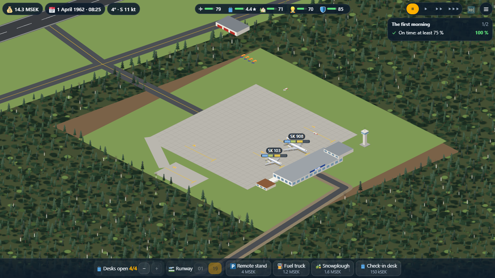

# Arlanda Rising

*[Read in English](README.md)* · *[Läs på svenska](README_SV.md)*

Игра-стратегия об управлении настоящим аэропортом — **стокгольмским Арландой** — по его настоящей истории. Ты директор: в сосновом лесу к северу от Стокгольма в 1958 году расчищаешь площадку, потом строишь диспетчерскую вышку и первый терминал, выбираешь стоянку для каждого SAS Caravelle и DC-8, открываешь стойки регистрации, заправляешь самолёты, чистишь снег тёмными зимними вечерами, зажигаешь огни полосы и делаешь молодой аэропорт прибыльным — до официального открытия 1 апреля 1962 года и первой зимы после него.

Аэропорт нарисован в изометрии и живёт у тебя на глазах: самолёты в цветах своих авиакомпаний садятся, рулят, обслуживаются на стоянках — трапы, бортпитание, багажные тележки, заправщики — и снова взлетают; колонны снегоочистителей с оранжевыми маячками чистят полосу; солнце ходит по настоящей широте, поэтому декабрьские вечера тёмные, а летние ночи светлые.

Глава 1, **«Лесное поле»**, готова: 11 миссий примерно по 5–7 минут (экзамен — около 10), разбитых на этапы и сохраняемых всё время. Следующие главы — реактивный век, переезд внутренних рейсов из Броммы, Arlanda Express, третья полоса, облако пепла, пандемия и Арланда 2040 года по твоему проекту — появятся в следующих версиях.

Играть можно по-английски, по-русски или по-шведски: язык выбирается вверху стартового экрана.

*Бесплатная некоммерческая фанатская игра; не связана со Swedavia или другими показанными компаниями и не одобрена ими. Названия и логотипы принадлежат их владельцам.*

## Как запустить

Открой [index.html](index.html) в браузере. Ничего собирать не нужно, сервер не нужен.

## Как играть

- **Новая кампания** начинается в мае 1958 года; **Продолжить** открывает хронологию кампании со всеми миссиями и их звёздами. На карточке миссии — рассказ Астрид, цель, две цели для дополнительных звёзд, этапы и что нового.
- **Этапы стройки** (каждую секунду проходит день): начинай работы на панели справа — каждая требует дней и денег, а одновременно их идёт столько, сколько у тебя бригад. Выбирай обычный или быстрый темп, покупай дополнения вроде тёплых зимних шатров, плати наличными или в кредит. Выбор (продать лес или сжечь? кафе или киоск?) останавливает время, пока ты не решишь.
- **Этапы работы аэропорта** (час идёт около минуты): **лоток задач** слева заполняется делами — «SK 104 сядет через 4 мин — выбери стоянку», «Очередь на регистрацию 12 мин — открой стойку», «SK 908 нужно топливо — пошли заправщик», «Снег на полосе — пошли снегоочистители». Нажми на задачу, чтобы сделать очевидное, или перетащи садящийся самолёт на стоянку по своему выбору (**Выбрать** подсвечивает подходящие стоянки). Пропущенную задачу берёт дежурный — он делает её поздно и не всегда хорошо.
- Панель внизу открывает и закрывает стойки регистрации, отправляет снегоочистители, выбирает направление полосы в штиль (на 01 садятся над Мэрштой, с 19 взлетают над ней — что пощадит город ночью?) и покупает мелочи: дальнюю стоянку, заправщик, снегоочиститель.
- Сверху — деньги, дата и время, погода и пять показателей: **Авиакомпании**, **Пассажиры** (в звёздах), **Соседи**, **Персонал** и **Безопасность**. Нажми на самолёт, чтобы увидеть его карточку и ход обслуживания.
- После каждого этапа карточка показывает, как он прошёл; за миссию — до трёх звёзд. Между миссиями **Офис** показывает деньги, кредиты и итоги последних месяцев.

### Миссии

Расчистить лес · Первые колёса (14 декабря 1959 года, первая посадка) · Вышка · Первый терминал (первый регулярный рейс — SAS DC-8 в Нью-Йорк 26 июня 1960 года) · Первые реактивные · Топливозаправщик · Первый снег · Чтобы окупалось · Ночные огни · День открытия (1 апреля 1962 года) · *Экзамен: первая зима*.

## Ничего не теряется

Миссия сохраняется каждые несколько секунд и в тот же миг, когда страница скрывается, — телефон заблокировался или лимит времени закрыл приложение. Открой игру снова, и **Продолжить миссию** вернёт ровно в тот момент, на паузе. Проигранный этап переигрывается, а не вся миссия.

## Управление

**Телефон и планшет:** игра открывается на весь экран. Одним пальцем двигай карту, двумя — меняй масштаб. Нажимай на задачу или перетаскивай её — или садящийся самолёт — на стоянку. Удерживай палец на самолёте, чтобы увидеть его карточку.

**Клавиатура и мышь:** щелчок и перетаскивание; колесо — масштаб, правая кнопка или стрелки двигают карту. **Пробел** — пауза / ход, **1–4** — скорость, **N** — к следующей задаче, **Q** — самая старая задача, **Esc** — меню паузы. В меню пробел или Enter нажимает выделенную кнопку.

## Сложность

Выбирается на стартовом экране, на карточке миссии, в меню паузы и на экране результатов; запоминается. Звёзды хранятся для каждой сложности отдельно.

- **Легко:** на 50 % больше денег, рейсы ближе к расписанию, погода спокойнее, авиакомпании терпеливее, сроки задач на 50 % длиннее, полгода в долгах до вмешательства владельца.
- **Средне:** игра такой, какой задумана.
- **Сложно:** на 25 % меньше денег, рейсы прилетают раньше и позже, суровая погода, нетерпеливые авиакомпании, сроки на 25 % короче, три месяца в долгах.

## Звук

Все звуки игра создаёт сама: реактивные и винтовые двигатели при каждой посадке и взлёте, сигнал новой задачи, гул снегоочистителей, гонг перед выбором, монетки и аккорды. **Звук** включается и выключается на стартовом экране и в меню паузы; выбор запоминается.

## Установка и офлайн

В меню браузера выбери **Добавить на главный экран** (или **Установить приложение**): игра будет запускаться на весь экран со своей иконки. Открытая один раз онлайн, она играется совсем без сети.

## Сохранение в браузере

Кампания, звёзды, текущая миссия и настройки хранятся в этом браузере. Синхронизация через аккаунт Google (чтобы продолжать с телефона на компьютере) появится в следующей версии.
