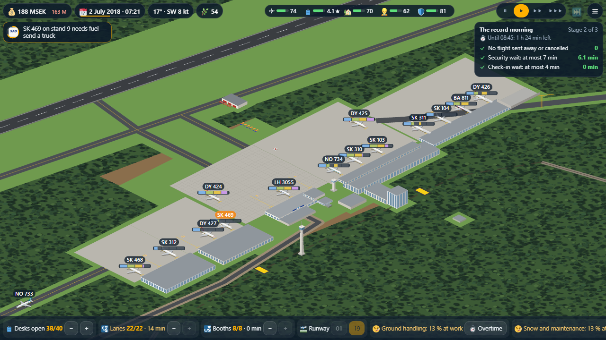

# Arlanda Rising

*[Read in English](README.md)* · *[Читать на русском](README_RU.md)*

Ett strategispel om att driva en riktig flygplats, **Stockholm Arlanda**, berättat genom dess riktiga historia. Du är chef: i tallskogen norr om Stockholm 1958 röjer du tomten, sedan bygger du flygledartornet och den första terminalen, väljer plats åt varje SAS Caravelle och DC-8, öppnar incheckningsdiskar, tankar jetplanen, plogar snön mörka vintereftermiddagar, tänder banljusen och får den unga flygplatsen att bära sig. Sedan kommer jeteran — jumbon, bana 2 för sidvindarna, utrikesterminalen 1976, inrikesflygen som flyttar in från Bromma 1983 — och arbetet blir för stort för dina händer: du anställer lag och deras chefer, sätter in de första datorerna och lär dig att maskiner går sönder och att fack strejkar.

Flygplatsen är ritad isometriskt och lever framför dig: plan i sina flygbolags färger landar, taxar, vänds på sina platser med trappor, catering, bagagevagnar och tankbilar, och lyfter igen; plogkolonner med gula blixtljus sopar banan; solen följer den riktiga breddgraden, så decembereftermiddagarna är mörka och sommarnätterna ljusa.

Tre kapitel är klara — **Skogsfältet** (1958–1963), **Jetåldern** (1965–1976) och **Alla kommer till Arlanda** (1983–1989): 33 uppdrag på ungefär 4–9 minuter vardera (ett prov omkring 10), delade i etapper och sparade hela tiden, och **fritt spel** efter kapitel 2. Nästa kapitel — Arlanda Express, bana 3, askmolnet, pandemin och ett Arlanda 2040 som du själv formar — kommer i senare versioner.

Spelbart på engelska, ryska eller svenska: välj språk högst upp på startskärmen.

*Ett gratis, icke-kommersiellt fanspel; inte knutet till eller godkänt av Swedavia eller något av de visade företagen. Namn och logotyper tillhör sina ägare.*

## Så startar du

Öppna [index.html](index.html) i en webbläsare. Inget byggsteg och ingen server behövs.

## Så spelar du

- **Ny kampanj** börjar i maj 1958; **Fortsätt** öppnar kampanjens tidslinje med alla uppdrag och deras stjärnor. Ett uppdragskort har Astrids genomgång, målet, de två målen för fler stjärnor, etapperna och vad som är nytt.
- **Byggetapper** (en dag går varje sekund): starta jobben i panelen till höger — varje jobb tar dagar och pengar, och bara så många åt gången som du har arbetslag. Välj normalt eller snabbt tempo, köp tillval som uppvärmda vintertält, betala kontant eller med lån. Ett val (sälja timret eller bränna det? ett kafé eller en kiosk?) stoppar tiden tills du bestämt dig.
- **Driftetapper** (en timme tar ungefär en minut): **uppgiftslistan** till vänster fylls med jobb — ”SK 104 landar om 4 min — välj plats”, ”Incheckningskö 12 min — öppna en disk”, ”SK 908 behöver bränsle — skicka en tankbil”, ”Snö på banan — skicka plogarna”. Tryck på en uppgift för att göra det självklara, eller dra ett landande plan till en plats du väljer (**Välj** tänder de platser som passar). En uppgift du missar går till vakthavande chef, som gör den sent och inte alltid bra.
- Raden längst ner öppnar och stänger incheckningsdiskar, skickar plogarna, väljer banriktning vid svag vind (på 01 landar man över Märsta, från 19 lyfter man över staden — vilket skonar den på natten?) och köper små saker: en fjärrplats, en tankbil, en snöplog.
- Överst syns pengarna, datum och klocka, vädret och de fem mätarna: **Flygbolag**, **Passagerare** (som stjärnor), **Grannar**, **Personal** och **Säkerhet**. Tryck på ett plan för att se dess kort och dess vändning.
- Efter varje etapp visar ett kort hur det gick; efter uppdraget får du upp till tre stjärnor. Mellan uppdragen visar **Kontoret** pengarna, lånen och de senaste månadernas bokslut.

### Lag, chefer och system (från kapitel 2)

- **Lag** tar en hel sorts uppgifter ur dina händer — platsplanerare, en ramparbetsledare, en diskfördelare, ett snölag, bagagehanterare, en utropare — mot lön varje månad. Ett nytt lag behöver två veckor före sitt första pass.
- **Människor är inga maskiner:** några är borta varje dag, många fler under influensasäsongen (januari–februari) och under semestern i juli om du inte sprider ut den. Ett lag som är kort skickar tillbaka en del av arbetet till din lista; **Övertid** i raden längst ner tar in alla för en etapp, mot betalning, och efteråt är de trötta. Säsongsvikarier täcker en del luckor.
- **Chefer** kommer i par, var och en med två styrkor och en svaghet (en snöchef som ”känner lukten av snö” men skickar övertidsräkningar i varje storm; en IT-chef som lagar fel dubbelt så snabbt men vill ha det nyaste systemet varje år). De ber om löneförhöjning och kan värvas av Köpenhamn, Oslo eller Helsingfors.
- **Facken** begär högre löner vartannat år: säg ja, bjud mindre (fackets humör avgör), be medlaren — eller säg nej och få en strejk en vecka senare. Under strejkdagar gör laget bara en sjättedel av sitt arbete.
- **System** (från 1970- och 80-talen: transportband, en dator för platsfördelning, skärmar med flyginformation, incheckningsdatorer, en väderbaserad röjningsplan) arbetar snabbt och rätt, men kostar licens varje månad, behöver IT-folk och går sönder. Ett system som ligger nere lämnar sitt arbete till laget du behöll intill — eller till dig, om du sade upp det. **Beredskapen** (hur väl personalen kan det manuella sättet) sjunker varje månad utan övning. Ett strömavbrott stoppar alla system utan reservkraft.
- Nya jobb på flygfältet: **bagage** (skicka vagnarna till varje ankomst — ombordstigningen väntar på dem), **utrop** (berätta för ett försenat flygs resenärer), **brandkategorin** (ett plan för stort för din räddningstjänst skickas någon annanstans), nödlandningar, dimma med instrumentlandningssystem och sidvind som stänger bana 1 medan bana 2 är öppen.
- På kontoret visar **Personal** (P) varje lags moral, skicklighet, trötthet, frånvaro och löner, facken och chefskandidaterna; **Ops Center** (O) visar varje områdes nivå, drifttid, månadskostnad och beredskap, och där sätter du in nästa nivå eller håller en övning.

### Fritt spel

Efter kapitel 2 erbjuder startskärmen **fritt spel**: en ändlös flygplats från en era som kampanjen har öppnat (1963, 1976, 1990). Varje omgång är en månads affärer — två erbjudanden från flygbolag, butiker, chefer, fack och leverantörer — och en hektisk topp med dina flygbolags egna linjer, utan stjärnor och utan ram.

### Uppdrag

**Kapitel 1, Skogsfältet:** Röj skogen · Första hjulen (14 december 1959, den första landningen) · Tornet · Den första terminalen (det första reguljära flyget, en SAS DC-8 till New York den 26 juni 1960) · De första jetplanen · Tankbilen · Första snön · Få det att bära sig · Nattljus · Invigningsdagen (1 april 1962) · *Prov: den första vintern*.

**Kapitel 2, Jetåldern:** Plats för jetplanen · Chartersommar · Anställ hjälp · Två chefer · Jumbo! (SAS första 747, 1971) · Brandkategori · Lönerörelsen · Bagagebandet · Dimmig morgon · Sidvind (bana 2) · *Prov: Utrikesterminalen* (1976).

**Kapitel 3, Alla kommer till Arlanda:** Linjeflyg flyttar in (oktober 1983) · Morgonrusning · Datorrummet · Skärmar · Influensasäsong · Strejkvarsel · Stora kylan · Planerare eller dator? · Återbetalning · Flygbussarna (1989) · *Prov: Inrikesrusning*.

## Aldrig förlorat

Ett uppdrag sparas med några sekunders mellanrum och i samma ögonblick som sidan döljs — en mobil som låses, en tidsgräns som stänger appen. Öppna spelet igen så fortsätter **Fortsätt uppdraget** från exakt det ögonblicket, pausat. En misslyckad etapp spelas om, inte hela uppdraget.

## Kontroller

**Mobil och surfplatta:** spelet går i helskärm. Dra med ett finger för att flytta kartan, nyp med två fingrar för att zooma. Tryck på en uppgift, eller dra den — eller ett landande plan — till en plats. Håll fingret på ett plan för att se dess kort.

**Tangentbord och mus:** klicka och dra; hjulet zoomar, höger knapp eller piltangenterna flyttar kartan. **Mellanslag** paus / spela, **1–4** hastighet, **N** hoppa till nästa uppgift, **Q** gör den äldsta uppgiften, **P** personal, **O** Ops Center, **Esc** pausmenyn. I menyerna trycker mellanslag eller Enter på den markerade knappen.

## Svårighetsgrad

Välj den på startskärmen, på uppdragskortet, i pausmenyn eller på resultatskärmen; den sparas. Stjärnor sparas för varje svårighetsgrad.

- **Lätt:** 50 % mer pengar, flyg närmare tidtabellen, lugnare väder, tålmodigare flygbolag, 50 % längre tid för uppgifterna, färre sjukdagar och systemfel, sex månader i skuld innan ägaren ingriper.
- **Medel:** spelet som det är tänkt.
- **Svår:** 25 % mindre pengar, flyg tidiga och sena, hårdare väder, otåliga flygbolag, 25 % kortare tid, fler sjukdagar och fel, tre månader i skuld.

## Ljud

Alla ljud skapas av spelet självt: jetmotorer och propellrar vid varje landning och start, en signal för en ny uppgift, plogarnas mullrande, högtalarens ding före ett val, mynt och ackord. **Ljud** På / Av finns på startskärmen och i pausmenyn; valet sparas.

## Installera och spela offline

Välj **Lägg till på hemskärmen** (eller **Installera app**) i webbläsarens meny: spelet startar då i helskärm från sin egen ikon. När det har öppnats en gång online går det att spela helt utan nät.

## Sparas i webbläsaren

Kampanjen, stjärnorna, det pågående uppdraget, det fria spelet och inställningarna sparas i den här webbläsaren.

**Synk via Google (valfritt):** **Logga in med Google** på startskärmen sparar kampanjen, stjärnorna, det fria spelet och till och med uppdraget du är mitt i i molnet, så att du kan spela på mobilen och fortsätta på datorn (”Fortsätt uppdrag — sparat på en annan enhet”). Inget ersätts: de två kopiorna slås ihop (stjärnorna från båda, kampanjen och uppdraget från den som sparades senast; en ny kampanj vinner över en äldre). En synk körs aldrig mitt i en etapp. Utan nätverk spelar spelet som vanligt och synkar när nätet är tillbaka; går molnkopian inte att ladda säger startskärmen det och erbjuder **Försök igen** eller **Spela med framstegen på den här enheten**. Utan inloggning lämnar inget webbläsaren.
