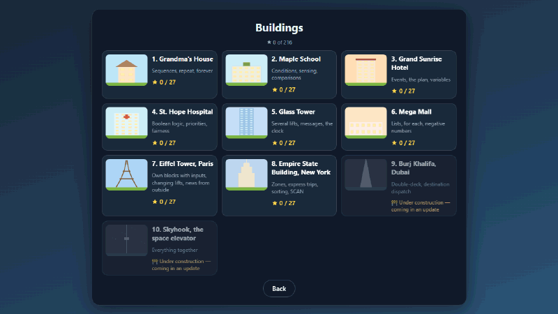

# Lift Logic

*[Читать на русском](README_RU.md)* · *[Läs på svenska](README_SV.md)*

A programming puzzle game for kids from about ten and for grown-ups: you are **Lifty, the brain of a lift**. People appear on the floors, press the call buttons and ride; you build the lift's program from colourful blocks and watch a whole building live by it. Your program only knows what a real lift knows — its floor, its buttons, the call buttons on the landings, its load, the clock. It doesn't see the people.

On the way you learn sequences, loops, conditions, sensing, events, variables, lists, blocks of your own and real lift algorithms: in **Grandma's House**, at **Maple School**, in the **Grand Sunrise Hotel**, at **St. Hope Hospital** (emergencies, hospital beds, slow patients), in the **Glass Tower** (two and three lifts running one program, messages between them, the clock and the rush hours), in the **Mega Mall** (car park floors below zero, shopping carts, a prankster, a lift out of order), at the **Eiffel Tower** in Paris (slow lifts in the legs, a change of lifts on the way to the summit, the wind and the Bastille Day fireworks) and in the **Empire State Building** in New York (102 floors, zones, express trips, a sorted to-do list and the SCAN algorithm) — 72 missions with three stars each, hints, an Inspector that explains what went wrong, jokes and a Lift Museum of real lift history. More buildings (the Burj Khalifa and a space elevator) are being built.

Playable in English, Russian or Swedish: pick the language at the top of the start screen.

## How to run

Open [index.html](index.html) in a browser. There is no build step and no server is needed.

## How to play

- **Continue** opens the next mission; **Buildings** shows them all. A mission card tells you the task, the three stars and the new blocks.
- The screen has the **building** at the top and your **program** at the bottom. Tap a colour chip (Lift, Sensing, Events, Control, Operators, Variables, Lists, My Blocks) to see its blocks and tap a block to add it under the selected one — or drag it where you want.
- **My Blocks** (from the Eiffel Tower on): **Make a block**, give it a name and, if you like, inputs — a number, a yes / no or a word. Its *define* hat appears among your scripts: put blocks under it, then use your new block anywhere. Inside the define script its inputs are small blocks you can put into slots.
- Tap a block of your program for its menu: **Move**, **Copy**, **Wrap** (put it inside an *if*, a *repeat* or a *forever*) and **Delete**. Tap a white slot to type a number on a big number pad, or to put a sensor block in it; a hexagonal slot takes a condition.
- **▶ Run** starts the day. The block that runs lights up, people's faces go from 🙂 to 😠 while they wait, and the lift says what you tell it to say. ⏸ pauses, ⏭ steps, **×1 / ×2 / ×4 / ×16** sets the speed and ⏩ skips to the end. 👁 **Lift's eyes** shows only what your lift can sense.
- Tap a person to see who they are and where they go; tap the cabin to see its plan and load. With several lifts (A, B, C) the one you tap is followed.
- A tall building doesn't fit on a phone: drag it, or tap the **minimap** strip at the right edge — it shows a tick for every call (red when someone has waited long) and a dot for every lift.
- **Text** shows your program as JavaScript-like text.

### Missions and stars

Every mission has three stars: the first is the goal (deliver everyone…), the other two are aims like a short average wait, little energy, few blocks or nobody giving up. Mission kinds: build a program, fill the gaps, fix the bug, a tiny program in few blocks, beat a number, and a busy exam at the end of each building — passing it opens the next building.

After a run you see your stars, your numbers next to the **Engineer's record**, a bar for each person's wait, up to three notes of **the Inspector** ("Mia waited 74 s on floor 4 — your lift passed floor 4 three times without stopping") with **Show me**, which replays the day to that moment, and a joke or two about the day. Beat the engineer for a 🏅. The first pass of every mission adds a card to the **Lift Museum**; passing an exam prints the building's newspaper.

### Hints

Tap 💡: hint 1 gives the idea; hint 2 (after runs that did not pass, or a few minutes) lights up the blocks you need and shows the shape of the engineer's program; hint 3 shows the engineer's solution. With it a mission gets at most ★★ until you change it into your own program.

## Controls

**Phone and tablet:** everything is a tap, and blocks can also be dragged. One finger drags the empty canvas, two fingers pinch to zoom; the same works in the building. Drag the bar with ▶ Run up or down to give more room to the building or to the code; double-tap it to give the whole screen to one of them. The game goes fullscreen when you start a mission.

**Keyboard and mouse:** drag blocks from the palette, right click a block for its menu. **Space** run / stop, **P** pause, **S** step, **1–4** the speed, **E** the Lift's eyes, **Delete** deletes the selected block, **Ctrl+Z / Ctrl+Y** undo / redo, **Ctrl+C / Ctrl+V** copy / paste a block, **Esc** the menu. On a wide screen the building, the palette and your program stand side by side. In the menus the arrow keys move between the buttons and Space or Enter presses one.

## Difficulty

Pick it on the start screen, in the pause menu or on the results screen; it is remembered. Stars are kept for each difficulty.

- **Easy:** people are 50 % more patient and come a little less often; the wait limits of the stars are 25 % looser; the Inspector also names the block that would help; hints open early.
- **Medium:** the day as it is meant to be.
- **Hard:** people are less patient (× 0.7) and come more often; the wait limits are 10 % stricter; the Inspector only shows the moment; hints open later.

## Sound and music

All sounds are made by the game itself: the arrival chime (once going up, twice going down — like real lifts), the doors, the motor's hum, the buttons, a "+1" for every arrival, a grumble when someone takes the stairs, the overload buzzer, star clinks and fanfares. The lift music plays softly while you build and livelier during a run. **Sound** and **Music** can each be switched off on the start screen and in the menu; the choice is remembered.

## Progress and the cloud

Your stars, cards and programs are saved in the browser. To go on with the same progress on a phone and a computer, press **Sign in with Google** on the start screen: your progress is then kept in the cloud and synced — when the game starts, when you come back to it and a few seconds after every change. Progress made on two devices is merged: the stars, medals and cards of both are kept, and each mission keeps the program you changed last. **Sign out** leaves the progress on this device. The cloud save works on the online version, not from a file opened on your computer. The game never waits for the cloud: without a network you play on with the progress on this device. If your cloud progress cannot be loaded, the start screen says so and offers **Try again** or **Play with the progress on this device** — it is merged with your account by itself once the network is back.
