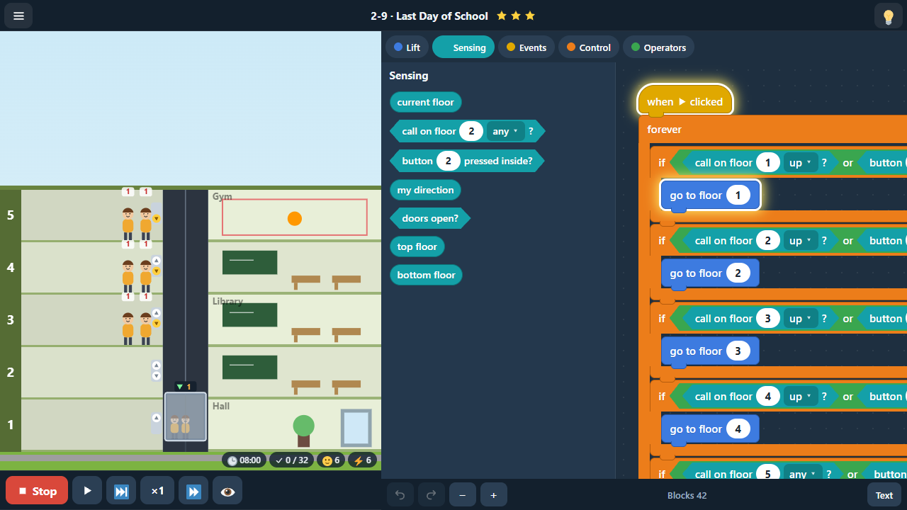

# Lift Logic

*[Read in English](README.md)* · *[Läs på svenska](README_SV.md)*

Игра-головоломка о программировании для детей примерно с десяти лет и для взрослых: ты — **Лифти, мозг лифта**. На этажах появляются люди, нажимают кнопки вызова и едут; ты собираешь программу лифта из цветных блоков и смотришь, как по ней живёт целый дом. Программа знает только то, что знает настоящий лифт, — свой этаж, свои кнопки, кнопки вызова на площадках, загрузку и часы. Людей она не видит.

По дороге ты узнаёшь, что такое последовательность, циклы, условия, датчики, события, переменные, списки и настоящие алгоритмы лифтов: в **Бабушкином доме**, в **Кленовой школе**, в **отеле «Гранд Санрайз»**, в **больнице Святой Надежды** (экстренные вызовы, больничные кровати, медленные пациенты), в **Стеклянной башне** (два и три лифта с одной программой, сообщения между ними, часы и часы пик) и в **Мегамолле** (этажи парковки ниже нуля, тележки, шалун и сломанный лифт) — 54 задания по три звезды, подсказки, Инспектор, который объясняет, что пошло не так, шутки и Музей лифтов с настоящей историей. Новые здания (Эйфелева башня, Эмпайр-стейт-билдинг, Бурдж-Халифа и космический лифт) ещё строятся.

Играть можно на английском, русском или шведском: язык выбирается вверху стартового экрана.

## Как запустить

Открой [index.html](index.html) в браузере. Сборка и сервер не нужны.

## Как играть

- **Продолжить** открывает следующее задание; **Здания** показывают все. Карточка задания рассказывает задачу, три звезды и новые блоки.
- Наверху экрана — **здание**, внизу — твоя **программа**. Нажми цветную кнопку (Лифт, Сенсоры, События, Управление, Операторы, Переменные, Списки), чтобы увидеть её блоки, и нажми блок — он встанет под выбранным. Или перетащи его, куда нужно.
- Нажми блок своей программы, чтобы открыть его меню: **Переместить**, **Копировать**, **Обернуть** (положить внутрь *если*, *повторить* или *всегда*) и **Удалить**. Нажми белое окошко, чтобы набрать число на большой клавиатуре или вставить туда блок-датчик; шестиугольное окошко принимает условие.
- **▶ Пуск** начинает день. Работающий блок подсвечивается, лица ожидающих меняются с 🙂 на 😠, а лифт говорит то, что ты ему велишь. ⏸ — пауза, ⏭ — шаг, **×1 / ×2 / ×4 / ×16** — скорость, ⏩ — сразу к концу дня. 👁 **Глаза лифта** показывают только то, что лифт может почувствовать.
- Нажми на человека, чтобы узнать, кто он и куда едет; нажми на кабину — увидишь её план и загрузку. Если лифтов несколько (A, B, C), экран следит за тем, на который ты нажал.
- Высокое здание не помещается на экране телефона: двигай его пальцем или нажми на **мини-карту** у правого края — на ней отметка для каждого вызова (красная, если кто-то ждёт долго) и точка для каждого лифта.
- **Текст** показывает программу в виде текста, похожего на JavaScript.

### Задания и звёзды

У каждого задания три звезды: первая — цель (доставить всех…), две другие — например, короткое среднее ожидание, мало энергии, мало блоков или чтобы никто не ушёл пешком. Виды заданий: собрать программу, заполнить пропуски, исправить ошибку, крошечная программа из немногих блоков, побить рекорд и в конце каждого здания — трудный экзамен; сдал его — открывается следующее здание.

После прогона видны твои звёзды, твои числа рядом с **рекордом инженера**, столбик ожидания каждого человека, до трёх заметок **Инспектора** («Мия ждала 74 с на 4-м этаже — твой лифт трижды проехал мимо, не останавливаясь») с кнопкой **Покажи**, которая повторяет день до этого момента, и шутка-другая о прошедшем дне. Обгони инженера — получишь 🏅. Первое прохождение каждого задания добавляет карточку в **Музей лифтов**; после экзамена выходит газета здания.

### Подсказки

Нажми 💡: первая подсказка даёт идею; вторая (после неудачных прогонов или через несколько минут) подсвечивает нужные блоки и показывает форму программы инженера; третья показывает решение инженера. С ним задание получает не больше ★★, пока ты не переделаешь его в свою программу.

## Управление

**Телефон и планшет:** всё делается нажатием, блоки можно и перетаскивать. Одним пальцем двигается пустое поле, двумя — масштаб; в здании так же. Потяни полосу с ▶ Пуск вверх или вниз, чтобы дать больше места зданию или коду; двойное нажатие отдаёт весь экран одному из них. При начале задания игра разворачивается на весь экран.

**Клавиатура и мышь:** перетаскивай блоки из палитры, правая кнопка мыши на блоке открывает его меню. **Пробел** — пуск / стоп, **P** — пауза, **S** — шаг, **1–4** — скорость, **E** — глаза лифта, **Delete** удаляет выбранный блок, **Ctrl+Z / Ctrl+Y** — отменить / вернуть, **Ctrl+C / Ctrl+V** — копировать / вставить блок, **Esc** — меню. На широком экране здание, палитра и программа стоят рядом. В меню стрелки переходят между кнопками, а Пробел или Enter нажимает кнопку.

## Сложность

Выбирается на стартовом экране, в меню или на экране результатов и запоминается. Звёзды хранятся отдельно для каждой сложности.

- **Легко:** люди на 50 % терпеливее и приходят чуть реже; лимиты ожидания для звёзд на 25 % мягче; Инспектор называет и блок, который поможет; подсказки открываются раньше.
- **Средне:** день такой, каким он задуман.
- **Сложно:** люди нетерпеливее (× 0,7) и приходят чаще; лимиты ожидания на 10 % строже; Инспектор показывает только момент; подсказки открываются позже.

## Звук и музыка

Все звуки игра делает сама: звонок прибытия (один раз вверх, два раза вниз — как у настоящих лифтов), двери, гул мотора, кнопки, «+1» за каждого доставленного, ворчание того, кто пошёл пешком, сигнал перегрузки, звон звёзд и фанфары. Лифтовая музыка тихо играет, пока ты собираешь программу, и живее — во время прогона. **Звук** и **Музыку** можно выключить по отдельности на стартовом экране и в меню; выбор запоминается.
