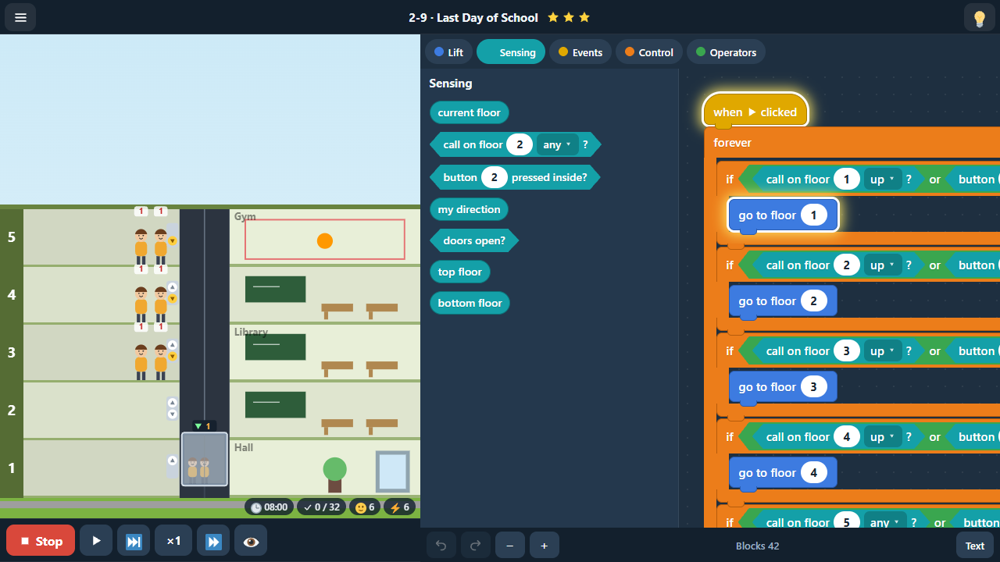

# Lift Logic

*[Read in English](README.md)* · *[Читать на русском](README_RU.md)*

Ett programmeringspussel för barn från ungefär tio år och för vuxna: du är **Lifty, hissens hjärna**. Människor dyker upp på våningarna, trycker på anropsknapparna och åker; du bygger hissens program av färgglada block och ser ett helt hus leva efter det. Programmet vet bara det som en riktig hiss vet — sin våning, sina knappar, anropsknapparna i trapphallarna, sin last och klockan. Människorna ser det inte.

På vägen lär du dig sekvenser, loopar, villkor, sensorer, händelser, variabler, listor, egna block och riktiga hissalgoritmer: i **Mormors hus**, på **Lönnskolan**, på **Grand Hotel Sunrise**, på **S:t Hopps sjukhus** (nödanrop, sjukhussängar, långsamma patienter), i **Glastornet** (två och tre hissar med ett program, meddelanden mellan dem, klockan och rusningstiderna), i **Megagallerian** (parkeringsplan under noll, kundvagnar, en busunge och en hiss ur funktion), i **Eiffeltornet** i Paris (långsamma hissar i benen, hissbyte på vägen till toppen, blåsten och fyrverkeriet på Bastiljdagen) och i **Empire State Building** i New York (102 våningar, zoner, expressturer, en sorterad att göra-lista och SCAN-algoritmen) — 72 uppdrag med tre stjärnor var, tips, en inspektör som förklarar vad som gick fel, skämt och ett hissmuseum med riktig hisshistoria. Fler byggnader (Burj Khalifa och en rymdhiss) håller på att byggas.

Spelbart på engelska, ryska eller svenska: välj språk högst upp på startskärmen.

## Så startar du

Öppna [index.html](index.html) i en webbläsare. Inget byggsteg och ingen server behövs.

## Så spelar du

- **Fortsätt** öppnar nästa uppdrag; **Byggnader** visar alla. Ett uppdragskort berättar uppgiften, de tre stjärnorna och de nya blocken.
- Överst på skärmen är **byggnaden**, nederst ditt **program**. Tryck på en färgknapp (Hiss, Känna av, Händelser, Kontroll, Operatorer, Variabler, Listor, Mina block) för att se dess block, och tryck på ett block för att lägga det under det valda — eller dra det dit du vill.
- **Mina block** (från Eiffeltornet och framåt): **Skapa ett block**, ge det ett namn och, om du vill, indata — ett tal, ja / nej eller ett ord. Dess *definiera*-hatt dyker upp bland dina skript: lägg block under den och använd sedan ditt nya block var som helst. Inne i definiera-skriptet är indatan små block som du kan sätta i fälten.
- Tryck på ett block i ditt program för dess meny: **Flytta**, **Kopiera**, **Omslut** (lägg det i ett *om*, *upprepa* eller *för alltid*) och **Ta bort**. Tryck på en vit ruta för att skriva ett tal på en stor knappsats eller lägga ett sensorblock i den; en sexkantig ruta tar ett villkor.
- **▶ Kör** startar dagen. Blocket som körs lyser, människornas ansikten går från 🙂 till 😠 medan de väntar, och hissen säger det du säger åt den. ⏸ pausar, ⏭ tar ett steg, **×1 / ×2 / ×4 / ×16** väljer hastighet och ⏩ hoppar till slutet. 👁 **Hissens ögon** visar bara det hissen kan känna av.
- Tryck på en person för att se vem det är och vart den ska; tryck på hytten för att se dess plan och last. Med flera hissar (A, B, C) följer skärmen den du tryckte på.
- Ett högt hus får inte plats på en mobilskärm: dra i det, eller tryck på **minikartan** vid högra kanten — den visar ett streck för varje anrop (rött när någon har väntat länge) och en prick för varje hiss.
- **Text** visar ditt program som JavaScript-liknande text.

### Uppdrag och stjärnor

Varje uppdrag har tre stjärnor: den första är målet (leverera alla…), de andra två är till exempel kort medelväntan, lite energi, få block eller att ingen ger upp. Uppdragstyper: bygg ett program, fyll i luckorna, rätta buggen, ett litet program med få block, slå ett tal, och ett svårt prov i slutet av varje byggnad — klarar du det öppnas nästa byggnad.

Efter en körning ser du dina stjärnor, dina siffror bredvid **ingenjörens rekord**, en stapel för varje persons väntan, upp till tre anteckningar från **inspektören** ("Mia väntade 74 s på våning 4 — din hiss åkte förbi våning 4 tre gånger utan att stanna") med **Visa mig**, som spelar upp dagen fram till det ögonblicket, och ett skämt eller två om dagen. Slå ingenjören för en 🏅. Första gången du klarar ett uppdrag får du ett kort till **hissmuseet**; efter ett prov kommer byggnadens tidning ut.

### Tips

Tryck på 💡: tips 1 ger idén; tips 2 (efter misslyckade körningar eller några minuter) tänder blocken du behöver och visar formen på ingenjörens program; tips 3 visar ingenjörens lösning. Med den får uppdraget högst ★★ tills du har gjort om den till ditt eget program.

## Styrning

**Mobil och surfplatta:** allt görs med tryck, och block kan också dras. Ett finger drar den tomma ytan, två fingrar zoomar; i byggnaden likadant. Dra listen med ▶ Kör upp eller ner för att ge mer plats åt byggnaden eller koden; dubbeltryck ger hela skärmen åt den ena. Spelet går över till helskärm när ett uppdrag startar.

**Tangentbord och mus:** dra block från paletten, högerklicka på ett block för dess meny. **Mellanslag** kör / stoppar, **P** paus, **S** steg, **1–4** hastigheten, **E** hissens ögon, **Delete** tar bort det valda blocket, **Ctrl+Z / Ctrl+Y** ångra / gör om, **Ctrl+C / Ctrl+V** kopiera / klistra in ett block, **Esc** menyn. På en bred skärm står byggnaden, paletten och programmet bredvid varandra. I menyerna flyttar piltangenterna mellan knapparna och Mellanslag eller Enter trycker på en.

## Svårighetsgrad

Välj den på startskärmen, i menyn eller på resultatskärmen; den sparas. Stjärnorna sparas för varje svårighetsgrad.

- **Lätt:** människorna är 50 % tålmodigare och kommer lite mer sällan; stjärnornas väntegränser är 25 % mildare; inspektören nämner också blocket som skulle hjälpa; tipsen öppnas tidigt.
- **Medel:** dagen som den är tänkt.
- **Svår:** människorna är otåligare (× 0,7) och kommer oftare; väntegränserna är 10 % strängare; inspektören visar bara ögonblicket; tipsen öppnas senare.

## Ljud och musik

Alla ljud gör spelet själv: ankomstsignalen (en gång uppåt, två gånger neråt — som riktiga hissar), dörrarna, motorns brum, knapparna, ett "+1" för varje ankomst, ett muttrande när någon tar trapporna, överlastsummern, stjärnklingande och fanfarer. Hissmusiken spelar lugnt medan du bygger och livligare under en körning. **Ljud** och **Musik** kan stängas av var för sig på startskärmen och i menyn; valet sparas.

## Framsteg och molnet

Dina stjärnor, kort och program sparas i webbläsaren. För att fortsätta med samma framsteg på en telefon och en dator, tryck **Logga in med Google** på startskärmen: framstegen sparas då i molnet och synkas — när spelet startar, när du kommer tillbaka till det och några sekunder efter varje ändring. Framsteg från två enheter slås ihop: stjärnorna, medaljerna och korten från båda behålls, och varje uppdrag behåller programmet du ändrade senast. **Logga ut** lämnar framstegen på den här enheten. Molnsparningen fungerar i onlineversionen, inte från en fil som öppnats på datorn.
