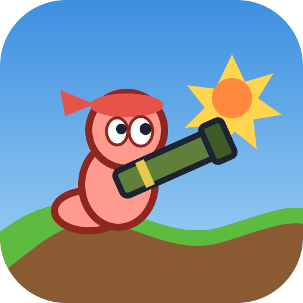
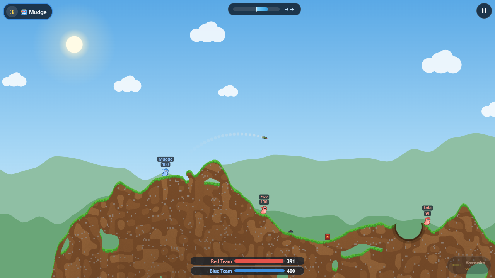

# Wiggle Wars

*[Читать на русском](README_RU.md)* · *[Läs på svenska](README_SV.md)*

A turn-based artillery game with little worms, in the spirit of Worms and Scorched Earth. Two teams take turns on a land that blows apart: walk, jump, aim, mind the wind and fire a bazooka, a grenade, an air strike or one of a dozen other weapons — then run for cover. Crates fall from the sky, oil barrels and mines go off, and a worm that falls into the water is gone. The last team standing wins.

Play **one against one on one phone or tablet** (pass it on after your turn), against the computer, or win the **campaign**: twelve missions with three stars each.

Playable in English, Russian or Swedish: pick the language at the top of the start screen.

## How to run

Open [index.html](index.html) in a browser. There is no build step and no server is needed.

## Versus

Press **Versus** and set up the match:

- **Teams:** a name, a colour and **Human** or **CPU** for each of the two teams. Human against human is hot seat on one device; you can also watch two computers play.
- **Worms per team** (1–6), their **health** (50–200) and the **turn time** (30–90 seconds).
- **The map:** Hills, Islands, Cavern, Canyon or a random one, with a preview and **New map** for another one. **The theme:** Meadow, Desert, Snow or the **Moon**, where the gravity is low and everything flies far.
- **Wind** (off, normal, strong), **crates** (off, some, many), **mines** and **oil barrels** on the map, **sudden death** after 8, 12 or 20 rounds (then the water rises after every turn).
- **Weapons:** switch each one on or off.

Everything you pick is remembered.

## Campaign

Twelve missions against the Rotters, each on its own map: target practice, battles on islands, in caves, in a minefield and on the Moon, grabbing a golden crate, a rising sea and a final battle against a bigger army. Every mission adds new weapons. Stars: in a battle ★★★ when your team keeps 60 % of its health and ★★ for 30 %; in target practice and the crate mission ★★★ for doing it in few turns. Win a mission to open the next one; the stars are kept for each difficulty.

## How to play

- On your turn you have a few seconds to walk, jump, aim and use **one** weapon. After a shot you still have three seconds to run (five after dynamite or a mine). Then the next team plays.
- **Hold Fire** to fill the power bar and let go to shoot: the longer you hold, the further it flies. The **wind** at the top carries bazooka shots and air strikes.
- **Grenades** bounce and go off when their fuse runs out: set it from 1 to 5 seconds.
- The **dotted line** behind your worm shows where your last shot flew, so you can correct the next one. On Easy and Medium a few dots ahead of the crosshair show where the shot will start to fly.
- A worm at 0 health blows up at the end of the turn; a worm that falls into the water is gone at once. Falling from high up hurts.
- **Crates** parachute in: health (+30), a weapon, or a tool. Walk into one to pick it up. An explosion destroys it.

## Weapons

- **Bazooka** — the basic shot, carried by the wind.
- **Homing Missile** — pick a target, fire; after half a second it turns towards it.
- **Grenade** — bounces, fuse 1–5 s. **Cluster Bomb** — a grenade that throws five bomblets.
- **Shotgun** — two instant shots a turn. **Bat** — sends a worm next to you flying (into the water, ideally).
- **Dynamite** — a huge blast five seconds after you drop it. **Mine** — goes off when a worm comes close.
- **Air Strike** — five bombs from the sky on the spot you pick.
- **Drill** — digs a tunnel along the aim. **Jetpack** — fly for four seconds, then land and use another weapon. **Teleport** — appear in any free place. **Plank** — a steel beam at any angle near you: a bridge, a roof or a wall.
- From crates only: **Double Damage** and **Low Gravity** for the rest of the turn.
- **Skip Turn**. Strong weapons have little ammo, and some can only be used after a few rounds.

## Controls

**Keyboard and mouse:**

- **← →** walk (and turn), **↑ ↓** aim (hold **Shift** to aim finely), **Space** — hold to charge, let go to fire.
- **Enter** jump, **Backspace** back flip, **1–5** the grenade's fuse.
- **Q**, **W**, **Tab** or the **right mouse button** open the weapons; click one to pick it.
- **Click** the map to pick a target (air strike, homing missile, teleport, plank), **drag** it to look around, the **wheel** zooms, **C** brings the camera back to your worm.
- **Esc** pauses (or closes the weapons).

**Phone and tablet:** the game goes fullscreen when you start. Touch the **left half** of the screen and a joystick appears under your finger: move it sideways to walk and up or down to aim (or to turn a plank, or to fly the jetpack). **Hold the big Fire button** at the bottom right and let go to shoot. **Jump** and **Back flip** are above it, the weapon button and the fuse next to it. **Tap** the map to pick a target, **drag** to look around and **pinch** to zoom. Walking and firing work at the same time with two fingers.

## Difficulty

Pick it on the start screen or on the results screen; it is remembered.

- **Easy**: the computer picks among its five best shots and often misses by a few degrees; a long aim guide shows where your shot will fly; the campaign's enemies have 20 % less health.
- **Medium**: the computer aims well; a short aim guide.
- **Hard**: the computer rarely misses (it knows the wind and how grenades bounce); no aim guide; the campaign's enemies have 25 % more health.

## Sound

All sounds are made by the game itself: explosions, launches, bouncing grenades, the shotgun, the bat, jumps, splashes, crates, the mine's beep, the jetpack and the drill, the turn chime and the last seconds ticking. Switch them off with **Sound: Off** on the start screen or in the pause menu. The choice is remembered. Big explosions also make a phone vibrate briefly.
