

# World Aviation

*[Читать на русском](README_RU.md)* · *[Läs på svenska](README_SV.md)*

<a href="https://gray0072.github.io/ivan/world-aviation/">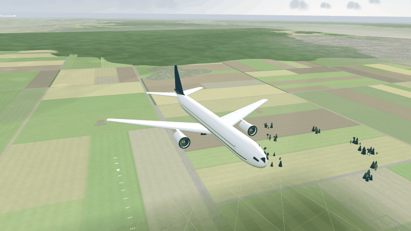</a>

A cockpit-view flight simulator and airline career in the browser. You are a young Swedish pilot with a fresh commercial licence (EASA CPL), based at **Stockholm Arlanda**, and earn the instrument rating, the ATPL and a captain's four stripes on the way. You start with Swedish domestic flights — Gothenburg, Malmö, Visby, Kiruna above the Arctic Circle — then win Scandinavia and the North Atlantic, and region by region the whole world: London and Paris, Dubai and Johannesburg, New York and Mexico City, Tokyo and Sydney. Every flight goes from gate to gate: push back, start the engines, taxi, take off, cope with the weather and with whatever breaks, land, and park at the gate.

- ✈️ **20 real aircraft** — from the Twin Otter bush plane to the A380, and the legendary An-225 Mriya
- 🌍 **141 airports, about 100 real airlines** — Sweden first, then Scandinavia and the world, region by region
- 🛫 **Gate to gate** — pushback, engine start, taxi, take-off, autopilot, ILS approach, landing, taxi in
- 🔥 **Emergencies** — engine fires, icing, windshear, bird strikes… handled with real QRH checklists
- 🎓 **Flight school** — seven short lessons for a pilot who has never flown
- 📱 **Anywhere** — keyboard or touch, phone or computer, English · Russian · Swedish, careers synced through Google

## How to run

Open [index.html](index.html) in a browser — no build step, no server required. The 3D view needs WebGL (three.js is included in the folder).

## Flight school

Seven short lessons in the simulator for a new pilot

New to flying? A new career opens with the **flight school** in place of the contract board: seven short lessons in the simulator, each one small job with a quick success, the instructor showing the buttons and the instruments it needs one at a time. A card at the top left lists the steps — the one to do now with why it is done — and lights up its button (on a phone) and the gauge it is about with a gold ring.

1. **Light aircraft** (Beechcraft 1900D): **Taxi** to the holding point, **Take-off** to 1500 ft, **Landing** from a short final.
2. **Medium aircraft** (Airbus A320): **From the gate to the autopilot** — push back, engine start, taxi, take-off, autopilot, time; **ILS approach and landing** — flaps and gear on the autopilot's approach, the last 200 ft by hand, spoiler, brakes.
3. **Heavy aircraft** (Boeing 777): **A whole flight** from the runway at Arlanda to the stand at Landvetter, with an icing checklist on the way, and the first officer taxiing in for you; then the **Graduation flight** — on the final into Arlanda go once round the camera views with **C** (on a touch screen **View**): from behind, from above, from the control tower (zoomed in on your jet), back to the cockpit to land; the first officer taxis you through a water salute of two fire engines, and you watch the stand from above to park on the stop bar. Then a fanfare, fireworks and your diploma.

The lessons are calm days, without emergencies but the one the whole flight teaches, and the instructor's hands are on the controls: the nose and the bank kept within safe limits, no stall, no climbing away in the flare and a too-fast touchdown caught, the nose kept on the centreline of the runway when you leave the stick alone, and no full power before you are lined up. After a failed try the next one helps more — the wings held level and the autopilot flying the glide path down to 60 ft, then the instructor flaring for you too. A lesson is free and changes nothing in the career. **I can fly — show the contracts** skips the school; it stays a line over the board and a card on the Training tab, to take or fly again any time.

## A flight

From gate to gate: push back, taxi, take-off, autopilot, landing, taxi in

1. **At the gate** press **Enter** — the tug pushes you back onto the apron — on a tow bar pinned at both ends, so in the turn it swings out to the side like a tractor with a trailer, and it pushes a few metres straight at the end to line the nose wheel up — lets go and drives off back to the stand. Start the engines (**Enter**) and watch N1 and EGT come up.
2. **Taxi**: **Space** releases the parking brake (on a phone: **Park**); a little power (**1**–**3**), steer with **← →**, brake with **B**, and follow the yellow arrow to the holding point. The arrow already points along the next leg as you come up to a turn; miss one and it finds you a new way on, and after landing it shows the nearest exit ahead (roll past it and it shows the next one; turn off at another exit and it leads on from that one). Round a corner the arrow, the first officer and the FOLLOW ME car all follow the curve painted on the taxiway, and where a curve is the way there is no square corner painted any more; where two turns come close together their curves share the straight between them, so the way never doubles back on itself. At each fork of the taxiway a yellow sign shows which stands the lane leads to (→ 4–6). On the ground the arrow lies on the ground in 3D, seen from wherever the camera is, so it points the way as you see it — from the cockpit, from behind, from the front or from the tower.
3. At the **holding point** set the take-off flaps (**F**) and ask for the clearance (**Enter**). Line up, full power (**9**), pull back (**↓**) at Vr, gear up (**G**).
4. **Autopilot** (**Y**): in NAV mode it flies the route, slows down on the descent (using the speed brake itself when it is high), turns onto the final approach without swinging through the centreline and follows the ILS glideslope down to 200 ft (60 m); it engages anywhere in the air above those 200 ft, on the approach too. It climbs like the real aeroplane, slower the higher it gets (an ATR 72 takes about 24 minutes to 20 000 ft). **T** speeds up time, **R** slows it down: with the autopilot on up to ×512 at any height from 200 ft — right after the take-off, as soon as it is engaged — flying by hand ×2 above 1 000 ft, ×4 above 3 000, ×8 above 6 000, ×16 above 8 000, ×32 above 9 000 and ×64 above 10 000 ft. Near the destination the time slows down by itself, a step every 3 seconds, back to ×1 5 km (2.7 nm) out.
5. **Approach**: the dotted glide path and the ILS scales come up as you close in on the runway — not while you fly past the airport or away from it. Flaps and gear down, land by hand from 200 ft (60 m) at Vref, brake, and slow below 35 kt (65 km/h).
6. **Taxi in** along the arrow, stop in the parking box at your gate and set the parking brake (**Space**). The engines shut down, the camera flies out — from the cockpit or from the outside view you were watching from — to the whole aeroplane from behind and above and stays while the ground crew drives up — the belt loader, the fuel truck, the catering truck, the airstairs or the cargo loader, each down the side clear of the wings and the engines (only the fuel truck goes under the wing) — then the debrief shows your grade and the invoice (a tap or **Enter** brings it at once). After a hard but safe landing — a thump, a bounce, a wing down, off the centreline or far down the runway — it adds a comic line about what that did to the passengers, the freight or the bush flight (the coffee in row 12 shooting up like a fountain, the zoo’s penguins lining up to surf the bounce again, the village postmaster’s long walk to the far end of the strip); a soft landing gets its line too (a coin stood on its edge in row 5 is still standing at the gate), and so does a moment of the flight — a go-around, a roll across the grass, a taxi overspeed, an emergency handled, nearly dry tanks, a strong crosswind, snow, the night, arriving early or late. After **2 flights in a type** (taxied in by hand) its first officer taxis in for you: press **Enter** (on a phone **Go**) after the landing, the time runs at up to ×4, and the first officer turns in to your stand and stops once the turn is behind — only the straight run onto the stop bar is yours. **Enter**, the stick or the brakes take the controls back at any moment. On your first landing at an airport a **FOLLOW ME** car waits past the runway exit and leads you to the stand round the taxiway's curves — catch up with it and it speeds up — then turns off on an arc just past your gate and waits beside the stand, out of your way and outside the ambulance, fire engine or police car that came to meet you; once the engines are off it drives away along the service road and parks by the terminal's baggage hall. The vehicles on the apron — the FOLLOW ME car, the baggage trains, the ground crew, the emergency services, the pushback tug — give way to each other: one with another just ahead waits until it has gone by.

**Mind the wingtips.** The buildings, the aircraft parked at the other stands the vehicles on the apron (baggage trains, fuel trucks, loaders, the ambulance, the police car) and the other aeroplanes, taxiing or flying, are solid. After a collision the camera goes outside and shows it. Touch something at a crawl — under 6 kt (11 km/h) — and your aircraft stops dead and is damaged; then you choose: **pay the compensation and go on** (a tug pulls you back 20 m along the way you came and you are back in your own view, the parking brake set; the compensation and the repairs come off the pay) or **end the flight** (the police drive up, the flight is lost, you pay the compensation and a small fine). Hit a vehicle at 6–15 kt and the police stop the flight with a small fine; hit a building or an aircraft at 6 kt or more, a vehicle at 15 kt or more, or anything in the air, and the flight is lost as in a crash — smoke rises from the spot. The other aeroplanes are watched by the tower: close in on one and you hear a caution first ("keep your distance"; on the ground "slow down and give way"), then an alert ("turn away now!"; on the ground "STOP"). Touch another aeroplane — at any speed, on the ground too — or come within a few metres of one in the air, and the flight is lost. **Enter**, **Space** or a tap move the pictures on. An aircraft too wide for an airport's stands (the An-225) gets the stands on either side of its own kept free.

The land below is a real landscape: fields in strips of every crop colour between lanes and hedges, farms, woods, villages, and grey cities with their street grids where the real ones are — more woods in the north, the tropics and the hills, sand in the deserts — so even from the cruise you see the ground slip by, and the haze thins as you climb out of it.

The briefing shows the route on a map — both airports with their flags and the great circle between them — and when you land in the arrival's local time; the weather at each airport gives the wind's direction ("12 kt from 270° (west)") and, on the runway, the crosswind and the side it comes from ("crosswind 9 kt from the right") or a tailwind; in flight the strip names your aircraft too. Pick the **departure time** on the briefing — day, dusk, night or dawn; dusk and dawn pay 5 % more, night 15 %. At night the stars and the moon are out — the moon in its phase, from a thin crescent to full, the same when you fly the flight again, and the stars turning slowly round the pole star, which you see well when you speed time up; the sky is the one over the aeroplane, so flying east the night passes faster and flying west the sunset follows you — the airport is its lights (approach lights, PAPI, blue taxiway edge lights and, at the big and medium airports, green centreline lights (green and yellow by turns where a line leads off the runway), which by day are on only in poor visibility, floodlit aprons with low lamps along their edge and lit terminals — every lamp shines steadily), your aeroplane shows its navigation lights, beacon and strobes, and your landing lights, switched on below 200 ft (60 m) as the autopilot lets go, light up the runway ahead. Below, the real towns and cities glow orange with white centres and their street grids, roads string them together, and villages and lone farms dot the land, so Stockholm, the Ruhr or Tokyo are where they should be. The clock runs on, so a long evening flight lands in the dark.

In the briefing, **Look around** takes you on a free camera flight round the departure or the arrival airport: in on the approach, low along the runway, over the terminal and down to your own aircraft at its stand (or at the holding point), at the hour and in the weather the flight will meet there. **Pause** at the bottom left (or **P**) stops it where it is, to look around at leisure; Enter, Space, Esc or a tap brings the briefing back sooner.

In the hangar every aircraft has a small **360° view** button on its picture: a free look at it in flight over the airport you are at, on a clear afternoon — the camera circles it from every side, rises over it and dives under its belly. **Pause** (or **P**) stops it to have a good look; Enter, Space, Esc or a tap takes you back to the hangar.

Before a flight you can **practise the landing** for a small fee (a share of the hourly lease): you start on the final at the destination, clean — gear and flaps up — the autopilot holds the glide path for 10 seconds and hands over 3 nm out, then you lower the gear and the flaps, land and brake below 35 kt. A good landing earns a little reputation with the client (A+ the most, C the least; only your best practice on each contract counts); a bad one costs nothing more than the fee. Then try again, go back to the briefing or fly it for real.

Starting **at the gate** and flying the whole ground routine yourself pays a bonus: +6 % of the contract and a little reputation. When you just want to fly, start **at the runway** — at the holding point with the engines running and the take-off clearance already given: set the flaps, line up and go. About 5 minutes less on the ground (and less lease on long flights), but no bonus. The game remembers which start you prefer.

## Controls

The keys, the mouse and the touch controls

- **↑ ↓** or **W S** — pitch (↓ pulls the nose up; **Nose up: ↑ Up** on the title screen or in the pause flips it, for the keys and the touch stick; each device keeps its own choice, so a phone can fly the other way round from the computer) · **← →** or **A D** — roll, and steering on the ground · **Q E** — rudder
- **− +** or **PageDown PageUp** — throttle · **1**…**8** — 10 %…80 % · **9** — full power · **0** — idle
- **Enter** — the next step on the ground: push back, engine start, take-off clearance
- **G** gear · **F / V** flaps down / up (hold to go all the way) · **B** brakes (hold) · **Space** parking brake · **/** spoiler · **K** anti-ice
- **Y** autopilot · **N** back to the programme (NAV along the route and the planned altitude, after you changed the heading or the altitude) · **, .** selected altitude · **; '** selected heading (HDG mode)
- **T / R** time faster / slower (hold to go all the way) · **C / X** next / previous view, **Z** straight to the cockpit; the views: cockpit, chase, front looking back, wing, tail fin, landing gear, top down, tower / fly-by (en route it cuts every few seconds between shots: waiting beside the flight path, ahead, far off to the side, behind) · **M** moving map (on a big screen: mini map, big map, off) · **I** instrument lights: dim, medium, bright, then a press hides the instruments for a clear view (the next brings them back dim) · **H** controls card · **Esc** pause (the flight stays in view behind it, dimmed; there you can also look at the flight's card and the aircraft's)

**On a phone or tablet** the game goes fullscreen when you start (where the browser allows it). The **left half** of the screen is a floating joystick — it rests faint in the bottom left corner, across from the Brake button, and jumps under your thumb wherever it lands (the **Joystick** switch on the title screen and in the pause hides it at rest, so it shows only under your thumb): drag down to pull the nose up, left and right to roll and to steer on the ground (the nosewheel and the control surfaces are hydraulic: they follow your thumb smoothly, not at once). The **slider on the right edge of the panel** is the throttle — its lower half gives fine control of low power for taxiing. The flight strip and the hint text sit on the left; tap either to fold or open it (the strip folds to the route; held upright there is no strip — the route is in the menu). The fuel shows only when it is short, as a red FUEL line. The buttons come in three rows: **Menu · View · Map · Ice** (anti-ice), **Flap − · Flap + · Gear · Spoiler**, and a row that changes with the flight — on the ground **Go** (push back, start, take-off clearance) on the left and **Park** (the parking brake — release it to taxi) on the right; from 200 ft (60 m) after the take-off **AP · NAV** (back to the programme) **· Time − · Time +**; and below 200 ft on the approach with the autopilot off, Go and the brakes again for the landing (switched off higher up — for a windshear, say — AP stays there to engage it again). The wheel brakes are the **Brake** button over the throttle slider, on the ground and on the approach from 200 ft, where the autopilot lets go (the ILS scales move left of it): they brake while you hold it. Hold Flap −/+ or Time −/+ and it keeps stepping — no need to tap again and again. The THR label at the top of the slider hides above 80 % thrust. The map closes with a tap anywhere on it. A switch that stays on lights up on its button: the autopilot, NAV and the gear down in green, the spoiler and the parking brake in red. Held upright (a phone or a tablet) the buttons run across the top and the four main gauges sit two by two on a taller panel, so the view keeps more than half the screen; on its side the four gauges stand in a row. A phone has no heading strip, and its ILS scales are smaller, without the words, in the bottom right corner of the view (a tablet's are there too, full size). While the camera flies to the aeroplane at the start the controls are hidden. On a tablet the messages stay on the left under the hint text, as on a computer. Both thumbs work at the same time, so you can fly and work a checklist together. The flight's card folds away on a phone: **The flight** in the pause shows it whole, with the figures of the moment — the flight time so far and still to go, the fuel, the weight, the local time at both airports and the air outside.

The controls work in any keyboard layout (the keys are read by their place on the keyboard).

**Sound**: jet fans whine and roar with the power, propellers beat, the wheels rumble over the slab joints, the brakes hiss, the gear and the flaps whir and clunk, the tyres chirp on touchdown — and the cabin answers the landing: a soft one gets applause (a really soft one an ovation with whistles), a firm one rattles the overhead bins, a rough one draws an "ooh!" and sends the cups flying in the galley, and after a hard one you hear gasps and a crying baby; a bounce gets a "whoa" (only with passengers on board) — and a voice calls "V one", "rotate" and the radio heights down to "ten" on landing, in the game's language and in feet or metres, as the units setting says. The **Sound** switch on the title screen and in the pause turns all of it off — the callouts and the cabin announcements too.

## Instruments

The panel: airspeed, attitude, altimeter, HSI and the rest

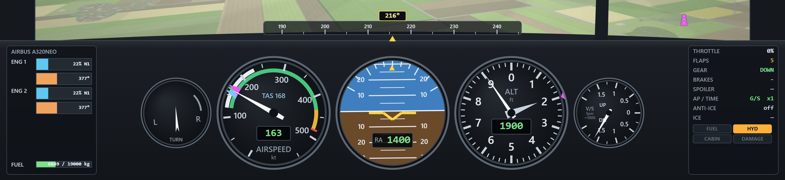

The panel on a computer screen, 4 nm out on the approach to Gothenburg with the gear and the flaps down and the autopilot on the glideslope. From the left: the engines, the turn coordinator, the airspeed, the attitude indicator, the altimeter, the vertical speed and the configuration block with the caution lights, with the heading strip above them. The panel stays on screen in every camera view. On a phone the four main gauges are bigger (held upright they sit two by two) and the configuration block keeps only the flaps, the gear, the autopilot and the ice (the rest is lit on the buttons); held on its side, they stand in a row.

| Instrument | What it shows and how it helps |
|---|---|
| 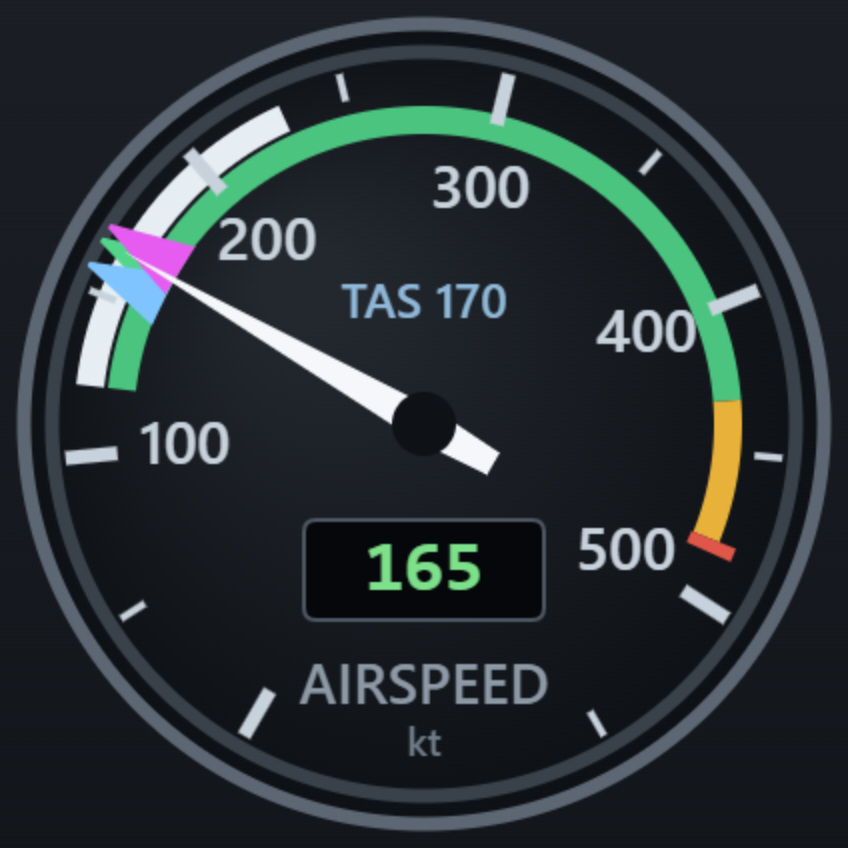 | **Airspeed** — the speed through the air in knots (km/h in metric), on the needle and in the window. Over the centre, **TAS** — the true airspeed: high up the air is thin and the needle reads far below the speed you really fly (a 737 cruising at 453 kt TAS shows about 250 kt); the autopilot holds the needle's speed. **Green arc**: the normal speeds with the flaps up. **White arc**: the flap range — it starts at the stall speed with the landing flaps, and the flaps may be lowered below its upper end. **Amber**: close to the limit, smooth air only. **Red line**: never exceed (Vne). The bugs on the rim: **blue** is Vr, where you pull back on the take-off roll; **green** is Vref, the speed to fly on the final; **magenta** is the speed the autopilot is holding. On the approach keep the needle on the green bug — faster and you float down the runway, slower and you sink or stall. |
| 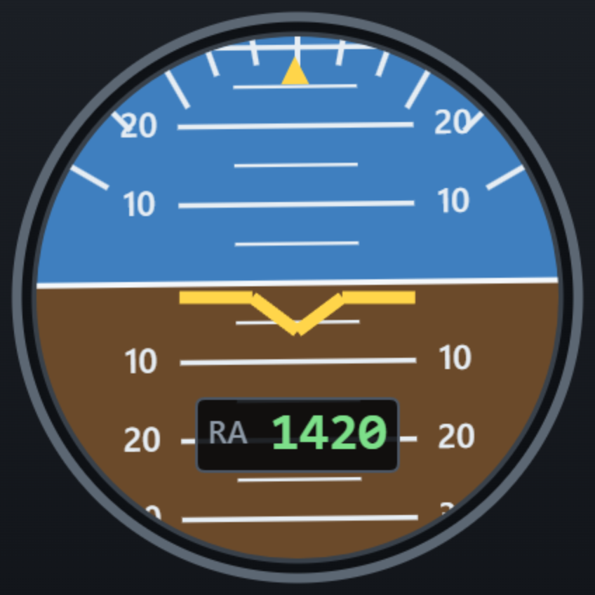 | **Attitude indicator** — where the nose and the wings are against the horizon: blue sky, brown ground, the yellow aeroplane symbol fixed in the middle. The lines are 5° of pitch apart; the scale at the top shows the bank (10°, 20°, 30°, 45°, 60°) with the yellow roll pointer. In cloud, in fog and at night it is the only way to know which way is up: about 10–15° nose up in the climb, near level on the final, 25° of bank in a turn (as the autopilot does). **RA** — the radio altitude, the height of the wheels above the ground (or the water) right below you. It appears below 2 500 ft above the ground, counts down to 0 at the touchdown and turns **amber below 200 ft** on the way down to land, with the "minimums" callout: from here you land by hand. Use it, not the altimeter, to time the flare — start raising the nose gently at about 30 ft. |
| 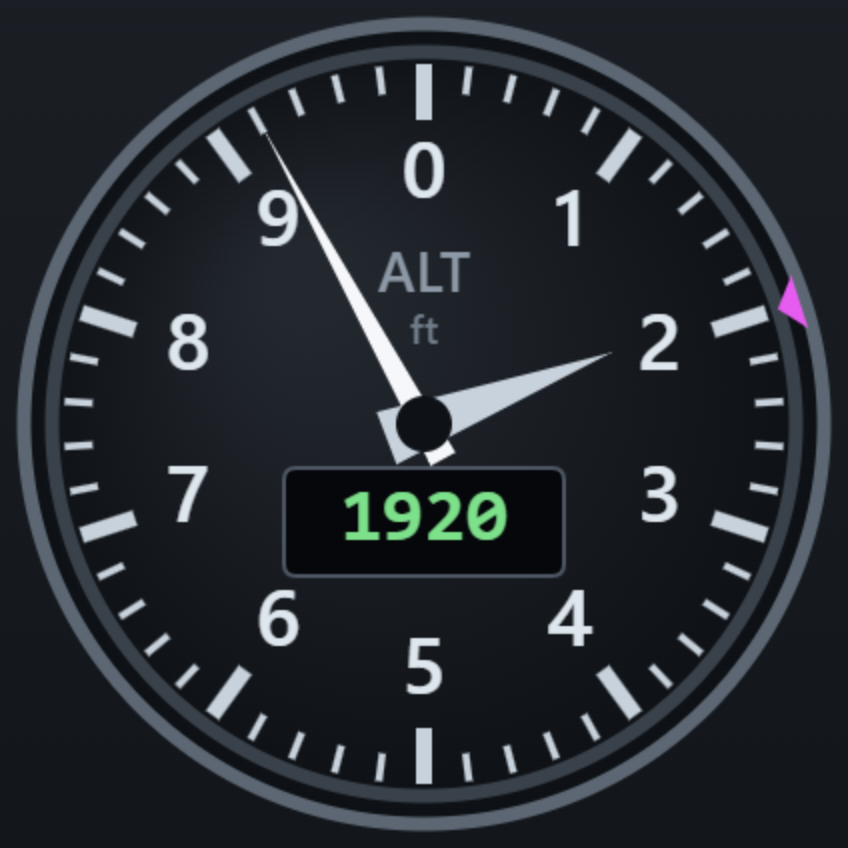 | **Altimeter** — the height above the sea, like a real one: the long needle shows hundreds of feet, the short one thousands, and the window the number (metric: one turn of the long needle is 1 000 m). The **magenta bug** on the rim is the altitude selected for the autopilot (**,** and **.**), on the short needle's scale — the short needle reaches it when you get there. It tells you your cruising level and how high you are over the hills and the sea. On the runway it shows the airport's own height, not zero: Mexico City sits 7 300 ft (2 230 m) above the sea, so for the landing look at the RA. |
| 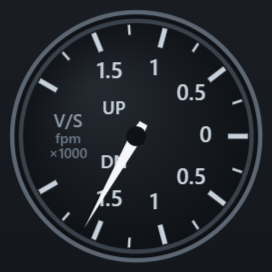 | **Vertical speed (V/S)** — how fast you climb or descend, in thousands of feet a minute (m/s in metric): zero on the right, climbs above it, descents below, up to 2 000 fpm (10 m/s). On a 3° glide path the descent is about five times the ground speed: 130 kt → about 650 fpm. Check it just before the touchdown — more than 600 fpm (3 m/s) is a hard landing, 1 000 fpm (5 m/s) breaks the gear. |
| 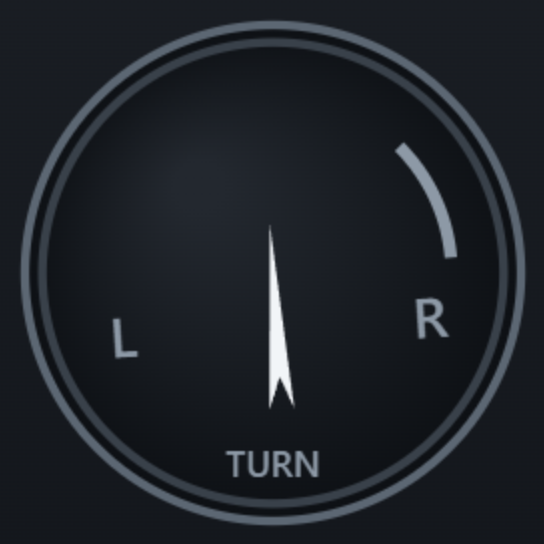 | **Turn coordinator** — the little aeroplane leans as far as the heading is changing: upright, you fly straight; the more it leans, the faster you turn. On the final keep it upright, so that you do not slowly drift off the centreline. |
| 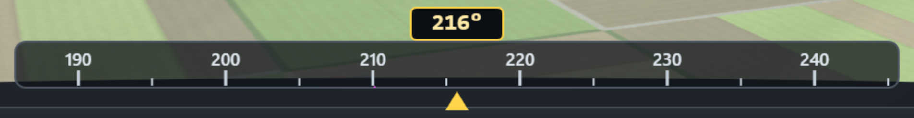 | **Heading strip** — the compass over the panel: the yellow triangle and the box are your heading. The **magenta triangle** under the strip is the bearing to the next point of the route (the runway on the approach) — turn until it sits under the yellow one and you are flying straight at it. In HDG mode a **blue mark** on top is the heading the autopilot is turning to (**;** and **'**). |
| 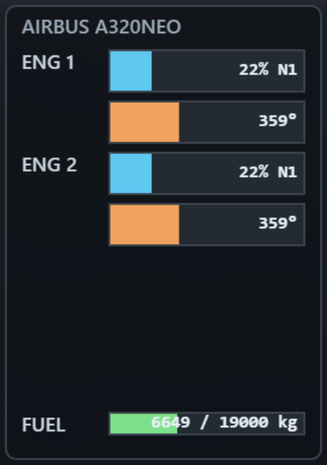 | **Engines** — two bars per engine: **N1** (the fan speed in %, that is the thrust; idle is about 22 %) and **EGT** (the exhaust temperature). During the start watch N1 and EGT come up; in flight the bar says **FIRE**, **FAIL** or **START** at once, so you know which engine has the problem. At the bottom: the **fuel** left, in kg out of the full tanks. |
| 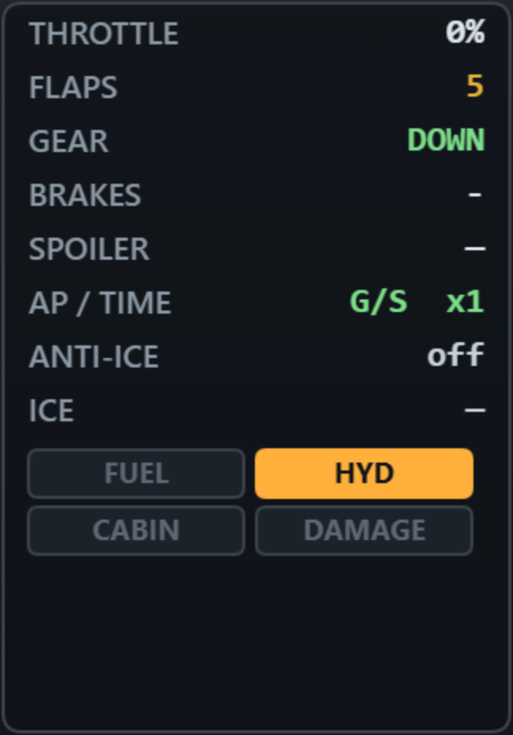 | **Configuration** — the state of everything you set, in words: **THROTTLE** in %, **FLAPS** (amber at the landing settings, "1>3" while they move), **GEAR** (green DOWN, amber while it travels), **BRAKES** (PARK — the parking brake is set), **SPOILER** (red OUT), **AP / TIME** (the autopilot mode — NAV along the route, HDG on a heading, G/S on the glideslope — and the time acceleration), **ANTI-ICE**, **ICE** on the wings in %. Under them four caution lights for what no other instrument shows: **FUEL** (a leak or low fuel), **HYD** (hydraulics), **CABIN** (pressure) and **DAMAGE**, in amber when lit — here a hydraulic failure; when the caution chimes the QRH checklist opens on the screen at the same time (see Emergencies). A fire or a failed engine shows on the engine gauges, a stall as STALL on the view. Before the landing one look says it all: gear DOWN in green, flaps set, spoiler in, parking brake off. |
| 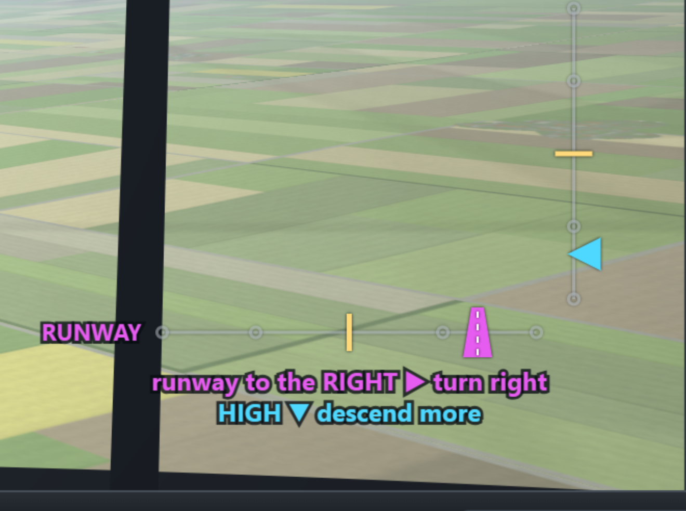 | **ILS** — on the descent and the approach (always in the bottom right corner of the windscreen, just above the panel, off the view ahead; on a phone smaller and without the words; on a computer smaller, and then without the words, when a checklist above leaves less room). The yellow marks in the middle are you. On the **RUNWAY** scale the little magenta runway sits where the runway is; on the **GLIDE PATH** scale the cyan triangle sits where the glide path is. Plain words under them say what to do — here "runway to the RIGHT ▶ turn right" and "HIGH ▼ descend more"; when both are right they say "ON THE CENTRELINE AND THE GLIDE PATH". Fly towards the symbols: the runway to the right means turn right, the triangle below means descend more. |
| 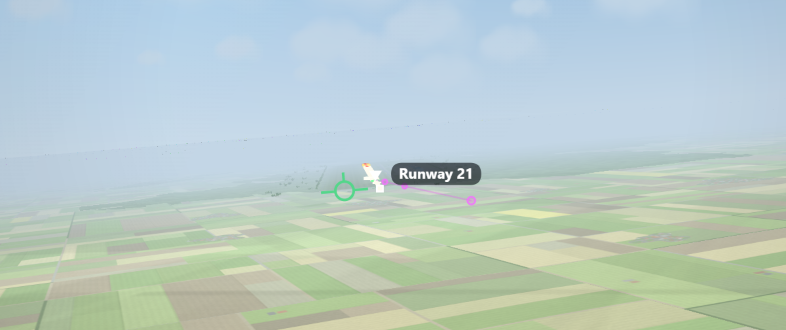 | **Glide path dots and the flight path marker** — in the sky, a see-through **magenta ring** every nautical mile on the extended centreline, at the height of the 3° glide path, down to the runway and its name; fly down the line of rings and you are on the ILS (here the aeroplane is left of the line and high). The **green circle** (cockpit view only) is the flight path marker: where the aeroplane is actually going, with the wind and the descent. Put it on the runway threshold and keep it there, and the aeroplane arrives at the threshold. |

The ILS scales and the glide path rings are the **landing aid**: switch them off on the title screen or in the pause to fly the approach on the instruments alone. Taxi speeds are by the ground speed (the wind moves the airspeed, not you): at most **40 kt** on a straight taxiway, **20 kt** on the apron lane, **10 kt** into the stand, and in a turn what its curve allows — **35 kt** off a rapid exit, **20 kt** off the last exit at the runway's end, **15 kt** into a lane. The runway exits slant off the runway at 45° (only the last one is square) and meet the taxiway where a lane goes on into the apron, so the arrow leads the gentlest way to your stand: through that lane and along the apron lane rather than a sharp turn back. Where an exit meets the taxiway only the turns some way to a stand takes are paved round and painted — the one onto the taxiway ahead only at an early exit with stands still ahead, such as the cargo or GA ones — so taxiing back along the taxiway from the runway's end no curve leads you back onto the runway, and an exit no way to a stand would take (past the apron) is not built at all. The speed and the limit for here — or for the turn or the apron coming up — show under the taxi arrow, and the airspeed gauge reads the ground speed while you taxi: green, **amber** over the limit, **red** over 1.25 times it. Two seconds in the red off the runway are reported as a taxi overspeed and fined (only lifting off counts as a take-off without a clearance). On a passenger flight the crew speaks to the cabin — before the take-off, at the cruise level (height, speed, the air outside), on the descent, before the landing and at the arrival (local time, temperature, ahead of or behind schedule); **Cabin announcements** turns them off.

## Emergencies

What can go wrong, and the QRH checklists

Every flight draws its problems: engine fire or failure, a fuel leak, icing, windshear, a bird strike, cabin depressurisation, a gear that will not come down, hydraulic or navigation failure, a medical emergency, a shifted load — and trouble in the cabin or from the ground: a power bank burning in a seat pocket, a drunk passenger, someone smoking in the lavatory, a laser from the ground on the approach, a baby on the way… When one happens the time acceleration stops, the caution sounds and a **QRH checklist** opens; once it is done the time speeds up again to where it was. Ice building on the wings with the anti-ice off stops the time the same way, until you switch the anti-ice on (**K**). Deal with it before the time is down at ×1 and it stops coming down there and speeds up again from where it got to. Leave the gear down after the take-off and a warning reminds you until it is up. An engine flaming out with no fuel, the autopilot letting go at a stall warning and the **LOW FUEL** warning (the FUEL light coming on in the air) bring the time back to ×1 for good — you fly by hand now, **T** speeds it up again. The checklist says what happened and lists the steps in order; the lit one is next, and each step shows the control that does it. Most are the real controls — thrust to idle with **0**, anti-ice **K**, the gear lever **G**, the speed brake **/**, the autopilot **Y**, pulling up with **↓** — and the checklist ticks them off as you do them; the switches that only exist in the checklist (a fire handle, a crossfeed valve, a call to ATC) are worked with **Enter** (on a phone: tap the lit step). Some things can go either way: the fire may need the second bottle, a failed engine may start again. Out of a windshear you go around and fly the approach again. Finish before the timer runs out and you see how long it took (the result card goes away by itself, or at once with a click or a tap); run out of time and the failure escalates — damage, lost engines, lost fuel, a lower pay. An altitude a checklist gives the autopilot (2 000 ft lower out of the icing, 10 000 ft after a loss of cabin pressure) holds only while the problem lasts: two minutes after it is over the autopilot climbs back to the planned level by itself (or press **N**), so the rest of the flight is not crawled low and slow. Whoever a checklist calls is waiting when you taxi in: an ambulance, an airport fire engine or a police car stands by your stand with its blue lights flashing.

## Difficulty

Chosen on the title screen and in the pause and debrief dialogs, and kept with the career (a new career starts at the level picked last):

- **Easy** — half the wind and light turbulence, one problem at a time, checklists explain why each step is done and give 50 % more time, and generous landing grading; every flight pays 20 % less.
- **Medium** — real wind and turbulence, sometimes two problems in one flight, checklists without the explanations, standard grading.
- **Hard** — strong wind and severe turbulence, two problems every flight, 25 % less time on the checklists, strict grading and more damage; every flight pays 25 % more.

## Career

Money, the network, the board, the hangar, training, the Mriya and round the world

Money is in Swedish kronor. Each contract pays for the distance and the load, plus bonuses for the landing grade, being on time and handled emergencies, minus the aircraft lease (per flight hour), the fuel burnt, repairs and penalties.

- **Network** — the world is opened a region at a time: **Sweden** (where you start), **Scandinavia & the North Atlantic** (Norway's fjords, Finland, Denmark, Iceland, Greenland, Svalbard), **Europe**, **Russia** (Moscow and St Petersburg, Kazan and Izhevsk, the Urals and Siberia, the Arctic from Murmansk to Khatanga, Vladivostok, Kamchatka and Anadyr), **the Caucasus & Central Asia** (Baku, Tbilisi, Yerevan, Almaty, Astana, Tashkent, Bishkek and Dushanbe — where the Russian airlines still fly abroad), **the Middle East & Africa**, **the Americas** and **Asia & the Pacific** — 141 real airports. Each region's traffic rights need flights and the reputation with the clients who invite you there (or with all three groups together), and cost money. From Arlanda the board offers the open regions; away from home it offers the flight back and onward legs, so the far side of the world is reached in legs of up to 4 500 nm (8 300 km).
- **Long haul** — on the autopilot the time acceleration goes up to ×512 at any height — in the climb, the cruise and the descent — over a world at its real size; Stockholm–New York takes a few minutes of real time. Approaching the destination the time comes down by itself, a step every 3 seconds (×512 ends about 200 nm out in a jet), to ×1 near the runway. The fast cruise is calculated ahead rather than step by step, so the autopilot flies it smoothly and the game stays light.
- **Contract board** — six offers at the start, then more as you open regions and fly (up to twenty). Passenger and freight work come in about equal numbers, and every card says how many times you have flown to that airport — or that it is new.
- **Hangar** — twenty real aircraft, lightest first: the **DHC-6 Twin Otter** bush plane, the 19-seat **Beechcraft 1900D**, the **Fokker F27** freighter, the **ATR 72-600** turboprop, the **Bombardier CRJ200** and **Embraer E195-E2** regional jets, the **Airbus A220-300**, **A320** and **A320neo**, the **Boeing 737-800**, the **Airbus Beluga** — the whale-shaped outsize freighter that flies wings and fuselage sections for Airbus, only for Airbus and only in its own paint, its cockpit under the bulging hold and a low crosswind limit for its huge body —, the **Boeing 767-300F** freighter, the bigger **BelugaXL** with a whale's smile painted on, the **Airbus A330-300**, the **Boeing 787-9 Dreamliner**, the **Airbus A350-900**, the **Boeing 777-300ER**, the giant **Antonov An-124** freighter that lands on gravel and ice, the four-engine **Boeing 747-8F** and the double-deck **Airbus A380**. Every card shows a picture of the aircraft's own 3D model, its key figures (seats, payload, range, cruise) and its real maximum take-off and empty weight (the briefing and the flight strip show the weight of your flight against it), speeds, runway needs and lease. A type that does not suit the airport you are at — its runway too short, a grass strip, or wings too wide for its stands and taxiways — carries a warning on its card, but you may still pick it.
- **The legend: the An-225 Mriya** — the heaviest aeroplane ever flown (640 t, six engines, 32 wheels), built in 1988 to carry the Buran shuttle and destroyed in 2022, waits at the top of the hangar as a pale hologram. Build it again yourself in its **assembly hall** whenever you like (to fly it you need every course passed): 50 real parts — from the wingtips and the radome to the six Progress D-18T engines and the centre wing — each with its real figures and what it is for, cheapest first, filtered by group, by the client group that vouches for it (passenger, cargo, bush & SAR) and by state. Each costs money (6 million kr in all, from 13 000 kr for the wingtips to 340 000 kr for the centre wing) and asks for a level of your reputation with one client group, from 5 for the cheapest to 70 for the dearest — the reputation is not spent, so the building can start early and goes on as you grow. Carry a bought part onto the blueprint and it snaps into its glowing place: drag it with the mouse or a finger, or pick it up with a click, a tap or Enter and move it with the arrow keys (Shift: finer) or a tap on its place. Every part fitted appears in the big turning hologram above and turns gold on the blueprint, and the hangar card — framed in gold before the build and after — fills in as the build grows. Its own colours are pearl white and champagne; ten more cost from 1 to 5 million kr — the real Mriya's white with the blue and yellow of Ukraine (1 million), midnight blue and burgundy (1.5), emerald and graphite and copper (2), satin-black obsidian (2.5), platinum (3), rose gold (3.5), the northern lights (4) and gold (5) — tried on before you buy, and switched for free on its hangar card or in the hall, before the build or after. The fiftieth part sets off fireworks and a fanfare over six engines spooling up — and the Mriya is yours to fly: your own aircraft, so no lease, but its upkeep is not cheap (42 000 kr per block hour).
- **The legend of the flights: round the world** — once you hold the traffic rights of every region and the ETOPS course, the card on top of the **Network** tab opens the expedition: from Arlanda round the globe and back in one aeroplane, by the rules of the real records — every leg the same way round, all 360° of longitude, at least 36 788 km (the length of the Tropic of Cancer; the quick way round the north is 1 500 km short, so you have to come south). Pick **Round the world** (a lost leg is flown again) or **Iron round the world** (one life: once a leg is off the ground it may end only at its arrival — pays double), one type for the whole way (Tokyo–Anchorage is 3 005 nm, so of the narrowbodies only the A220 goes round), and one of three routes — *Northern Pacific*, *Classic* or *Southern Cross*, each either way round — or draw your own on a globe you turn with a finger (tap an airport to add it; tap the last one again, or ↶ Undo in the globe's corner, to take it off — the globe stays where you turned it). The Meridian Club pays every leg like a contract and paints the aeroplane; between legs you fly the board as usual and the expedition waits at its stop. Every landing stamps your passport; in flight banners mark the equator, the date line (a day lived twice, or skipped) and halfway round. Back home the fire engines throw a water arch over your aeroplane, then come fireworks, a medal for your pilot's card (silver, iron, or gold for the Mriya's), a certificate to save as a picture, 1.5 million kr and +5 reputation everywhere (Iron: double), marks for each class of aircraft, records and a history. Flying the Mriya round the world earns its Meridian colours, which cannot be bought.
- **Training** — 28 courses in four branches (General, Passenger, Cargo, Bush & SAR). Each ends in a short exam (3 of 4 right) and unlocks aircraft, contract types or real advantages: checklist hints, more time in emergencies, slower icing. The courses open one by one: each asks for the course before it, its own number of flights flown (1 for Regional Turboprops, 3 for Aviation Weather … 46 for BelugaXL Differences) and, in the client branches, reputation with those clients. In the passenger branch every type has a course of its own, one every three to five flights — the ATR at 1, the CRJ at 5, then the E195-E2 at 8, the A220 13, the 737 16, the A320 20, the A320neo 25, the A330 28, the 787 32, the A350 37, the 777 40 and the A380 44 — so you fly each new type three to five times before the next one opens. The cargo branch does the same from the 767 on: after the F27 at 7, the 767 freighter at 30, the 747-8F 34, the An-124 39, the Beluga 42 and the BelugaXL 46. Every course has its own picture; its card ticks off what it asks for with how far you have come, lists the aircraft it unlocks, and a card on top shows the courses passed, the ones open now and the one that opens next. The four branches stand side by side on a computer, in two columns on a tablet, one under another on a phone; tap or click a branch's heading to fold it to a row of small badges (a branch passed to the end folds by itself) and again to open it — the choice is remembered. A course you have passed shrinks to one line with its picture, its name and a green tick, so the long branches stay easy to look through; tap or click the line to open the card. The type courses have exams of their own: **Regional Turboprops** (the ATR 72: propellers, feathering, icing; +10 % on short legs), **Fly-by-Wire Jets** (the E195-E2: flight computers and envelope protection), **Clean-Sheet Narrowbody** (the A220: a composite wing, a glass cockpit, side-sticks), **New Engine Option** (the A320neo: bigger fans, sharklets, less fuel), **ETOPS & Ocean Crossings** (the A330: two engines over the ocean; +10 % on long legs), **Composite Long-Haul** (the 787: carbon fibre, the cabin air, the relief pilot), **Heavy Twin & Ultra Long Haul** (the 777: its thrust, six-wheel bogies, step climbs, polar routes), **Double-Deck Operations** (the A380: two decks to board, the widest wing, the heaviest wake), **Heavy Freighter Ops** (the 767 freighter: the main-deck door, the pallets, no windows), **Jumbo Freighter** (the 747-8F: the nose that swings up, the cockpit in the hump, the fuel stop in Anchorage), **Outsize Cargo** (the An-124: the lifting nose, the kneeling gear, the roof cranes), **Beluga Super Transporter** (the Beluga: aircraft sections for Airbus, the cockpit under the hold) and **BelugaXL Differences** (the BelugaXL: both wings of an A350 at once, the painted smile).
- **Filters** over the board and the hangar, remembered between visits: show only passenger, cargo or bush & SAR contracts (the board offers only what your aircraft may fly anyway) and sort them by novelty (the places you have never flown to first), reputation, pay, difficulty or distance; in the hangar pick first what the aircraft is for (passengers, cargo, bush & SAR — round badges by each type's name show it too), then the kind of aircraft (turboprops, regional jets, narrowbodies, widebodies, freighters), the weight class (up to 30 t, 30–100 t, over 100 t) or only the types you may lease, sorted by weight, range, payload or lease. Press the active sort again to turn it round.
- A gold dot on **Training** or **Network** means a course or traffic rights are ready for you right now. The open courses are named at the top of **Training** — a tap on a name brings that course into view — and a course opened since you last looked is brought into view and lit up by itself. A type your exam has just unlocked lights the dot on **Hangar** and waits there first in a gold frame; every card shows how many flights you have flown in that type. Each region's card on **Network** shows its map — its airports lit in gold, your base ringed — and the flags of its countries.
- The menus work from the keyboard too: the arrow keys move between the buttons, **Enter** presses one (the focus stays where it was, so you can go on from there), **Esc** goes back. The main action of a screen is the gold button with an arrow (→), the way back the button with ← at the top left.
- **Career** — your pilot's card (tap the pencil to change the name), the rank, reputation with three client groups, licences, records and the log.
- **Licence and rank** — you start with a fresh **EASA CPL** and one gold stripe on the sleeve. The Instrument Rating course makes it **CPL/IR** (two stripes); CRM & Cabin Safety and 30 flights the **ATPL** (three); 40 flights and 17 courses make you **Captain** (four stripes), and every course passed **Senior captain** (four and a star). The Career tab shows the ladder and what the next rank asks for; a promotion is celebrated on the debrief or the exam's result. Below −50 000 kr nobody will lease you an aeroplane any more and the career is over.

## Balance and progression

What pays, what earns reputation and how long the career takes

- **The work pays, not the miles.** A flight is about a quarter of an hour of play whatever its length, so a leg pays for its take-off and landing more than for its cruise: every leg pays for the landing (a short hop in a big jet pays its way), and the miles past 800 nm pay half. A long leg still pays more — just not many times more.
- **The harder, the better paid.** Every contract shows its difficulty in stars ★: mountains, an Arctic field, a runway short for your aeroplane, a remote strip, dangerous goods or a patient. Each star above the first pays 8 % more and earns 8 % more reputation. The first flight to an airport you have never been to pays 10 % more and earns more reputation. **Hard** pays 25 % more, **Easy** 20 % less.
- **Bigger aeroplanes pay more, step by step.** A flight earns about 30–50 000 kr in a turboprop, 70 000 in a regional jet, 140 000 in a narrowbody, 230 000 in a widebody, 360 000 in the heaviest (A380, 747-8F, An-124) and 800 000 in the Mriya. A freighter earns about what an airliner of its size does. Bush and rescue flights pay a mission fee for every star, more with every Bush & SAR course, so a hard flight in a Twin Otter stays worth flying.
- **Reputation comes from the work, not the weight of the load:** about 2 a flight in a turboprop, 3.5 in the heaviest. The less you have with a client group, the faster it grows — the group you have neglected is the one worth working for. It is never spent: it opens the courses, the regions and the Mriya's parts.
- **No single way through.** The regions are opened by their own clients — the passenger airlines invite you to Europe and the Americas, the cargo carriers to Russia, cargo or bush operators to Africa — or by all three groups together; the courses by their branches; the Mriya by all three. Prices grow with the pay: a course or a region costs a few flights of what you fly when it opens.
- **How long.** A pilot who always picks the best of the board flies the ATR at flight 1, the Twin Otter at 4, the CRJ at 5, the E195-E2 at 8, Europe at 10, the A220 at 13, the 737 and the instrument rating at 16, the A320 at 20, the A320neo at 25, the A330 at 28, the 767 freighter and the ATPL at 30, the 787 at 32, the 747-8F at 34, the A350 at 37, the An-124 at 39, the 777 at 40, every region by about 41, the Beluga at 42, the A380 at 44, the BelugaXL at 46, has every course by about 48 and the Mriya built by about 61 — some 16 hours. With the two flights round the world it is about 75 flights; most pilots take about a hundred.

## Careers and the cloud

Several careers on one device, and a cloud save with Google

Several careers can live on one device: **Careers** on the title screen lists them — pilot, licence, flights, money and where each one is saved — and opens any of them. Every career keeps its own progress and its own settings (difficulty, graphics, sound, units, controls, filters); the language is the game's and stays as it is. A new career starts with every setting at its default, and the careers before it stay in the list.

To fly the same career on a phone and a computer, press **Sign in with Google** on the title screen or on the Career tab — or start a new career with **Start with Google** on its screen (the pilot's name comes from your account unless you typed one): that career is then kept in the cloud and synced — when it is opened, when you come back to the game, and a few seconds after every flight. Each career has its own sign-in, so careers of different Google accounts can share a device; the Career tab offers the accounts already used here with one press. On another device, **Careers from a Google account** brings all that account's careers. Progress made on both devices is merged: the courses, aircraft, regions, Mriya parts and records of both are kept, the money and the board come from the one played last. Signing out of a career leaves it on this device; deleting a career deletes its cloud copy too.

## Airlines and airports

About a hundred real airlines and 141 recognisable airports

The clients are real airlines: SAS, Norwegian, Finnair and Widerøe at home, then Lufthansa, British Airways, KLM, Emirates, Qatar Airways, Delta, Qantas, Aeroflot, S7 and about 80 more — passenger airlines, cargo carriers (DHL, FedEx, UPS, Cargolux, West Atlantic) and bush and air ambulance operators. Each has its logo on the contract board, and your aeroplane flies in the colours of the airline that hired it, titles on the fuselage and the emblem on the fin; the home carriers stand at the gates and have their logos on the hangars. An airline only takes the routes it could really fly: domestic flights belong to that country's own airlines (no Aeroflot from Stockholm to Kiruna), a passenger airline flies from or to its own country or one of its bases, each airline works only in its own regions, and there are no flights between Russia and Europe or North America — from Moscow the way home goes through Istanbul, Baku or Dubai.

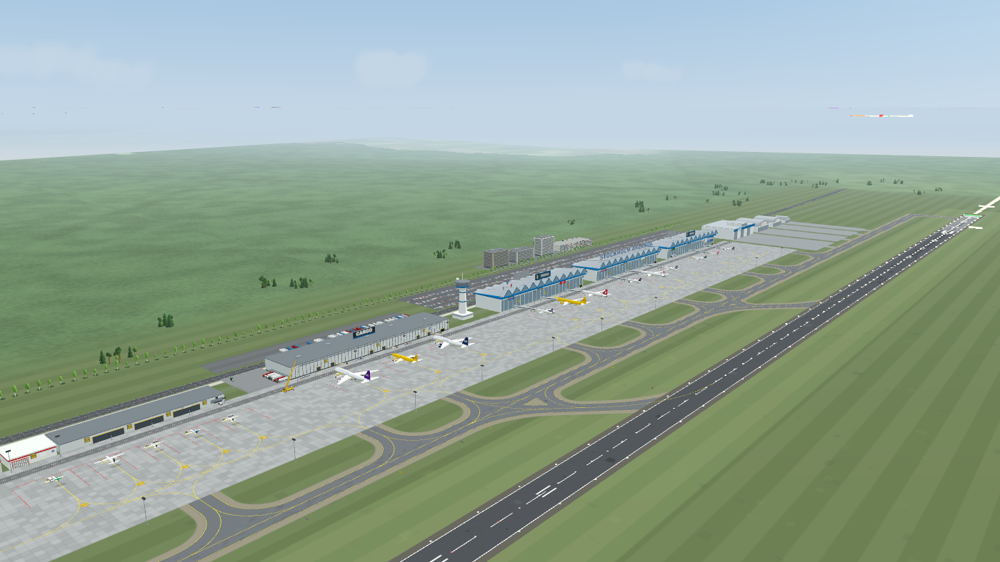

*Stockholm Arlanda from the air: the general aviation and rescue base with its fire station on the left, the cargo terminal with freighters at their stands and a mobile crane, the tower, the three terminals with aircraft at the gates and the maintenance hangars at the far end of the apron.*

Every airport is recognisable from the cockpit: its name in big letters on the terminal roof, a "Welcome" banner with the city's landmark (the Three Crowns of Stockholm, Big Ben, the Eiffel Tower, the Burj Khalifa, the Sydney Opera House…), the national flag and the city flag on the roof and over the tower — they stream with the wind, like the windsock. At the Russian and Swedish airports the third flag on the roof is the region's: Udmurtia's black, white and red with its red sun sign at Izhevsk, Tatarstan's at Kazan, the Skåne flag at Malmö, Västergötland's lion at Landvetter, the Sámi flag at Kiruna; with the game in Russian a Russian airport has its name on the roof and its welcome banner in Russian («ИЖЕВСК»), with the game in Swedish a Swedish one in Swedish («GÖTEBORG LANDVETTER»). Their boards advertise what the place makes — Ижмолоко and ИЖ at Izhevsk, Чак-чак and КАМАЗ at Kazan, Volvo and Göteborgs Kex at Göteborg, Skånemejerier at Malmö, LKAB at Kiruna — and the country's own: СБЕР, Простоквашино, Почта России; Arla, Marabou, ICA: lit boards on the terminal front beside the stands (you see them from the cockpit at the gate), billboards by the access road and a name in big letters on the office roof. Baggage trains come out of the baggage hall in the terminal, drive along the service road between the stands and the building and take the bags out to a departing aeroplane or fetch them from one that has come in — yours too, while it stands at the gate; they give way to your aeroplane and wait until it has passed. **Other aeroplanes come and go too**: the neighbour ahead of you on your way to the runway is pushed back while you board, taxis out and takes off in front of you (the tower clears you "behind the departing…"), one lands ahead of you on the final ("number two — traffic ahead") and is at its gate before you touch down, and one lands after you — or goes around if you are still on the runway. They never need you and keep out of your way: the runway is yours while you are on it or cleared onto it, and on the ground they stop and wait for you; the prompt says "traffic ahead" when one is in front of you on your way, and the first officer taxiing in slows down for it. A big hub's terminal is taller and wears a roof of its own: one sweeping wave over the whole building on raked struts (Madrid, Beijing, Doha), a row of barrel vaults with glass in their ends (Kuala Lumpur, Paris, Frankfurt), white tent peaks (Denver) or a sawtooth of folded plates rising over the apron (St Petersburg, Oslo, Arlanda). A chain-link fence runs round the airside, and outside it grow the trees of the place: spruce, pine and birch in the north, larch in Siberia, oak and poplar in the temperate belt, cypresses and stone pines by the Mediterranean, date palms in the desert, coconut palms in the tropics, acacias on the savanna, eucalyptus in Australia — and only low scrub in the tundra; in winter the leaves are gone, in autumn they turn. Big terminals are signed Terminal 1 and Terminal 2, the others Departures and Arrivals, and the bigger the airport, the more stands behind it: offices, a hotel, a multi-storey car park. The tower stands between the terminals and the cargo area — on its own in the open apron between them at a medium or a big airport, rising out of the end of the terminal at a small one — and grows with the airport too: a concrete post with a small cab at a tiny field, a slender round tower at a small one, a tall tapering one on a base building with a radar dome at a big hub — and so do the hangars: one small shed with a pitched roof, then arched hangars, and at a big airport a huge maintenance hangar for the wide-bodies. Every airport paints its buildings in its own colours: concrete grey, sand, white and blue, brick, dark steel, cream and green, red Swedish-style sheds or silver with red roofs — and the big famous ones look roughly like the real thing: Pulkovo's golden roof, Denver's white tent roof, Jakarta's terracotta roofs, Gardermoen's oak, KLM-blue hangars at Schiphol, Lufthansa's at Frankfurt, Aeroflot's at Sheremetyevo, Emirates' at Dubai. Runways have concrete ends with joints, tyre marks, shoulders and blast pads, edge and centreline lights, approach lights with a running flasher and a working PAPI (two white, two red: on the glide path); taxiways have shoulders and edge lines that follow every curve on both sides, the apron has concrete slabs and stand markings, and a road, a car park and a perimeter road surround the field. Airports grow with their size, from one terminal with a single stand to three terminals of five stands each, and lanes lead off the taxiway into the apron at both ends, between the terminals and between every two stands; the taxiway corners, the turn-offs and the turns into the stands are wide curves (55 m, 45 m into a stand), easy to follow with a big jet. A big airport has two or three terminals, each with its number on the building and painted on the road in front; your stands are set with the contract — the departure from the terminal nearest the runway's start, the arrival anywhere — shown on its card and kept when you fly it again. **Freight has stands of its own**, past the terminals along the same apron, numbered C1, C2…: a big airport has a **cargo terminal** with two to five of them, a smaller one a **cargo apron** with one or two in front of a cargo shed. A contract that carries freight (anything but passengers or a medevac) leaves from a cargo stand and arrives at one — "Cargo terminal, stand C2", "Cargo apron, stand C1"; follow the CARGO sign on the roof and the C plates on the lead-in lines. Round it the freighters of the cargo carriers stand at their stands with a main-deck loader lifting a pallet to the cargo door, containers wait on dollies by the building with netted pallets and forklifts, container trains come out of the cargo hall to the aircraft (yours too), trucks are backed onto the dock doors, trailers fill a truck park behind it, and at the bigger airports a mobile crane for outsize loads stands beyond the last stand. **Past the cargo area every airport has a general aviation and rescue base**: GA stands G1, G2… in front of the GA terminal and the bush operators' hangar, the air ambulance's own stand and hangar (with the Star of Life), the rescue station with a rescue helicopter on its pad (a Mi-8 in the Russian rescue service's colours in Russia) and the air ambulance's helicopter, and the airport's fire station with its fire engines. Bush flights in a Twin Otter, a 1900D or an F27 leave from a GA stand and arrive at one ("General aviation, stand G2"), a medevac from the air ambulance's stand to the air ambulance's stand; a post van in the country's post colours, a reefer van for the fish or a pickup with crates waits beside your aeroplane, and an ambulance for the patient. When an emergency calls them, the fire engine and the police drive out of the fire station and the ambulance out of its hangar along the apron to your stand, blue lights flashing. The remote strips (Vardø, Røst) are gravel, with a little red timber house for a terminal and fuel drums by the apron. Each big airport signs its terminals in its own typeface and colour. Taxiing, any outside view keeps the pilot's view in a small frame in the corner (where the mini map goes), so you can watch the aeroplane from outside and still see the way ahead; it gives way to the mini map after take-off. **C** also has a camera looking straight down from under the belly. Every flight begins with a short camera flight: a wide shot of your aeroplane at the terminal (or at the runway), then the camera sweeps in over the tail and drops into the captain's seat; parked at the arrival gate, it flies out of the cockpit (or from the outside view you were watching from) to the aeroplane at its gate before the debrief. **Enter**, **Space**, **Esc** or a tap skips it.

## Exams

Every course ends in a short exam: four questions, three right to pass. They are written in plain words — a school pupil can work them out — with a **Hint** button and an explanation after every answer, and they run in the game's language — **English, Russian or Swedish**.

## Language

English, Russian or Swedish

The whole game — the menus, the briefings and debriefs, the prompts and messages in flight, the emergency checklists, the touch buttons, the courses and the exams — is in **English, Russian or Swedish**. The title screen is a sky above a sea of clouds drifting past — golden at dawn and dusk, blue by day, starry at night, following your own clock — with airliners of real airlines flying through it in turn. Pick the language with the flags at the top of the title screen (EN · RU · SV); the choice is remembered (the first time the game takes the language picked in the gallery, else your browser's). The airports and their cities are named in your language (Göteborg, Moskva and Peking in Swedish; Стокгольм-Арланда in Russian), and the cabin announcements say them in the voice's language; the airline names and the names painted at the airports stay as they are; the instruments speak your language too. Wherever a city is named, its country is beside it (Kiruna, Sweden) — the flags alone do not always say it.

## Units and the map

Aviation or metric units, and the map in flight

**Units** on the title screen (and in the pause): aviation units — feet, knots, nautical miles, fpm — or **metric**: metres, km/h, kilometres, m/s, rounded to sensible numbers. Prompts, messages, screens and the instruments all follow the setting.

The **moving map** (**M**) draws the track you have actually flown — yellow on the ground, green in the air — over the planned route. On a big computer screen a **mini map** stays in the top right corner while you fly; **M** switches between the mini map, the big map and no map. The maps show the arrival runway with its final approach (a dashed line and an arrow in the landing direction). On a phone or a tablet the map fills the screen and zooms in as you get closer, like the mini map.

On the approach the **ILS** scales and the **glide path rings** show the way to the runway — see [Instruments](#instruments).

## Graphics

The quality presets for phones and computers

On the title screen and in the pause (a change applies at once, in the middle of a flight too). **Auto** (the default) picks Medium on phones and High elsewhere; if the frame rate drops it first leaves out what is missed least — the trees in the dark, every other cloud, half the lights of the towns at night — then lowers the resolution a little, and only then the level; when the frame rate is back up it brings them back. **Minimal**, **Very low**, **Low**, **Medium** and **High** set the terrain detail, draw distance, clouds and trees. The two lightest are for a big screen on a modest graphics chip (a tablet): the picture is drawn at a lower resolution, nearer, with fewer clouds and night lights, smaller airport textures, and the aeroplanes parked at the gates only close up. On every level the arrival airport is built while the flight loads, so the descent into it does not stutter.

## Tech stack

Plain HTML + CSS + vanilla JavaScript split by concern into folders — `core/` (helpers, language, input, sound), `data/` (airports, countries, airlines, exams, the Russian and Swedish texts, coastlines), `art/` (flags, city symbols, airline emblems), `sim/` (the world, terrain, flight dynamics, systems), `render/` (the 3D models, the hangar pictures, airports and scene) and `ui/` (instruments, cockpit, HUD, screens), with `game.js` and `career.js` on top — no build step. The 3D world uses three.js (vendored as `lib/three.min.js`), the cockpit and instruments are Canvas 2D, and the sound is synthesized with the Web Audio API.
