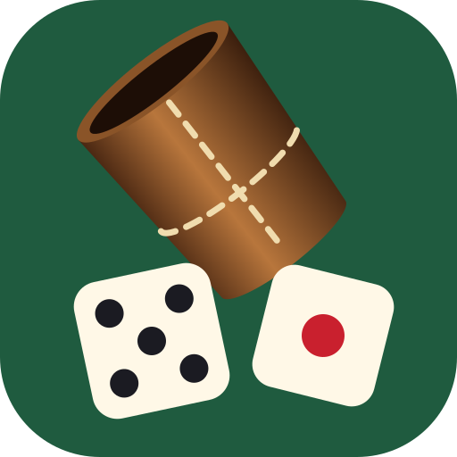
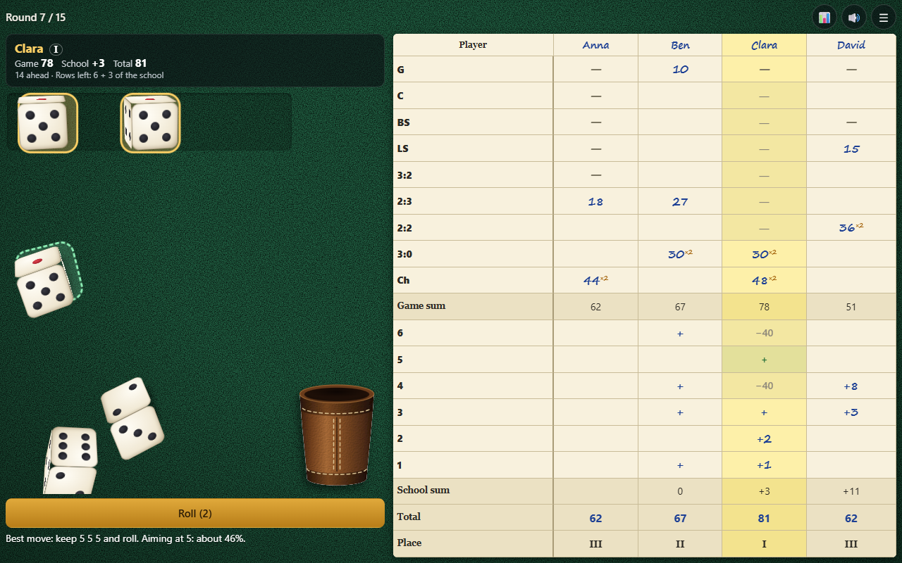

# Yacht

*[Читать на русском](README_RU.md)* · *[Läs på svenska](README_SV.md)*

The dice game Yacht, also known as Yahtzee and dice poker, for 1 to 10 players passing one device round. Shake the leather cup, tip the dice out on your table, keep the ones you like and fill the score sheet.

The game can be played in English, Russian or Swedish: pick the language at the top of the start screen.

## How to run

Open [index.html](index.html) in a browser. Nothing to build, no server needed.

## How to play

- Before the first game make a **group**: its name and up to 10 players in turn order. You can keep several groups, each with its own statistics.
- On your turn you roll up to three times. Tap the dice you want to keep, then roll the others.
- After any roll write the dice into one free row of your column, even if they score nothing there. After 15 rounds the highest total wins.
- **A combination written after the first roll counts double.**

| Row | Name | Needs | Points |
|---|---|---|---|
| G | General | five of a kind | the five dice |
| C | Carré | four of a kind or five | the four dice |
| BS | Big straight | 2-3-4-5-6 | 20 |
| LS | Little straight | 1-2-3-4-5 | 15 |
| 3:2 | Full house, three higher | three of one face, two of a lower one | the five dice |
| 2:3 | Full house, pair higher | three of one face, two of a higher one | the five dice |
| 2:2 | Two pairs | two pairs of different faces | the four dice |
| 3:0 | Three of a kind | three of a kind or more | the three dice |
| Ch | Chance | anything | the five dice |

**School (rows 6 to 1):** three dice of the row's face close it, written as `+`, no points. Each die more adds that face: four twos score 2, five fours score 8. A row not closed costs −40.

An unfinished game stays saved, so you can come back and press **Continue**. **↩ Undo** takes a written row back until the next player rolls.

## Difficulty

The levels change only the help, not the rules:

- **Easy:** free rows show what the dice would score, and the best move is suggested with the other moves under it. **All moves** lists everything you can do now and the gain of each move; the **?** button explains why a move is best and what it means for your final total.
- **Medium:** free rows show what the dice would score, no advice.
- **Hard:** no help, work the points out yourself.

## The table

Choose its colour (green, blue, burgundy, charcoal, walnut, sand) and texture (felt, wood, leather, linen, marble) on the start screen or in the pause. **Sound** can be switched on and off there too, or with the 🔊 button.

## Statistics

The 📊 button shows a group's statistics: wins, averages, best and worst games per player, average points per row, and the list of games.

## Controls

**Phone and tablet:** the game goes fullscreen. Tap the cup or Roll, tap dice to hold them, tap a free row to write. The sheet scrolls with a finger.

**Mouse and keyboard:** click the same things. Space rolls, keys 1–5 hold or release a die, Esc pauses.
