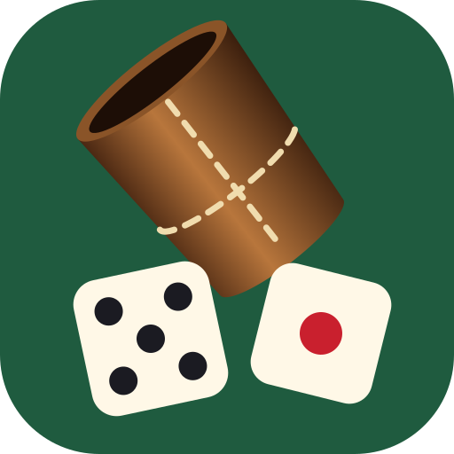
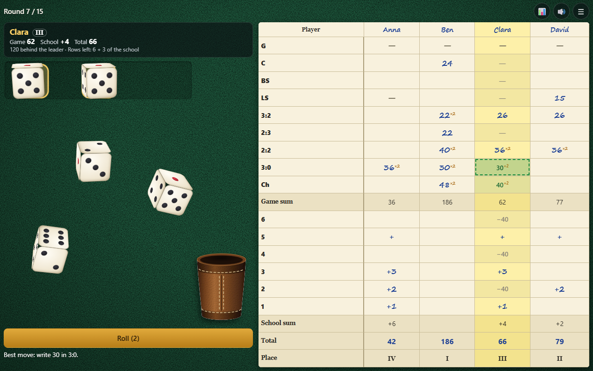

# Яхт

*[Read in English](README.md)* · *[Läs på svenska](README_SV.md)*

Игра в кости Яхт, она же Yahtzee и покер на костях, для 1–10 игроков, которые передают друг другу одно устройство. Потрясите кожаный стакан, высыпьте кости на свой стол, оставьте нужные и заполняйте лист.

Играть можно на английском, русском или шведском: язык выбирается вверху стартового экрана.

## Как запустить

Откройте [index.html](index.html) в браузере. Собирать ничего не нужно, сервер тоже не нужен.

## Как играть

- Перед первой игрой создайте **группу**: её название и до 10 игроков в порядке хода. Групп может быть несколько, у каждой своя статистика.
- За ход можно бросить кости до трёх раз. Нажмите на кости, которые хотите оставить, и бросьте остальные.
- После любого броска запишите результат в одну свободную строку своего столбца, даже если он там ничего не даёт. После 15 ходов побеждает наибольшая сумма.
- **Комбинация, записанная после первого броска, считается вдвойне.**

| Строка | Название | Что нужно | Очки |
|---|---|---|---|
| G | Генерал | пять одинаковых | сумма пяти костей |
| C | Каре | четыре одинаковых или пять | сумма четырёх костей |
| BS | Большой стрит | 2-3-4-5-6 | 20 |
| LS | Малый стрит | 1-2-3-4-5 | 15 |
| 3:2 | Фулл-хаус, тройка старше | три одной грани, две грани младше | сумма пяти костей |
| 2:3 | Фулл-хаус, пара старше | три одной грани, две грани старше | сумма пяти костей |
| 2:2 | Две пары | две пары разных граней | сумма четырёх костей |
| 3:0 | Тройка | три одинаковых или больше | сумма трёх костей |
| Ш | Шанс | любые грани | сумма пяти костей |

**Школа (строки от 6 до 1):** три кости нужной грани закрывают строку, пишется `+`, без очков. Каждая кость сверх трёх добавляет эту грань: четыре двойки дают 2, пять четвёрок дают 8. Незакрытая строка стоит −40.

Незаконченная игра сохраняется, можно вернуться и нажать **Продолжить**. Кнопка **↩ Отменить** возвращает записанную строку, пока следующий игрок не бросил кости.

## Сложность

Уровни меняют только подсказки, правила те же:

- **Легко:** в свободных строках видно, сколько дадут кости, и подсказывается лучший ход.
- **Средне:** в свободных строках видно, сколько дадут кости, советов нет.
- **Сложно:** без подсказок, очки считайте сами.

## Стол

Цвет (зелёный, синий, бордовый, графит, орех, песочный) и фактура (сукно, дерево, кожа, лён, мрамор) выбираются на стартовом экране или в паузе. Там же включается и выключается **звук**, а ещё его переключает кнопка 🔊.

## Статистика

Кнопка 📊 показывает статистику группы: победы, средние, лучшие и худшие игры каждого игрока, средние очки по строкам и список игр.

## Управление

**Телефон и планшет:** игра открывается на весь экран. Нажмите на стакан или «Бросить», нажимайте на кости, чтобы оставить их, и на свободную строку, чтобы записать. Лист прокручивается пальцем.

**Мышь и клавиатура:** те же действия щелчком. Пробел бросает, клавиши 1–5 оставляют кость или отпускают её, Esc ставит на паузу.
