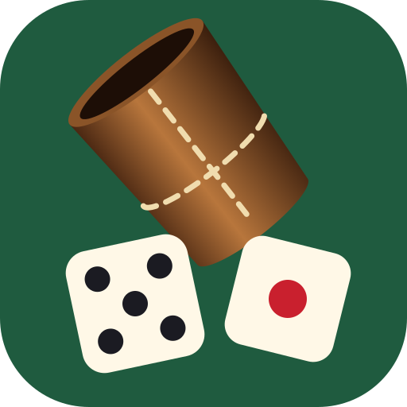
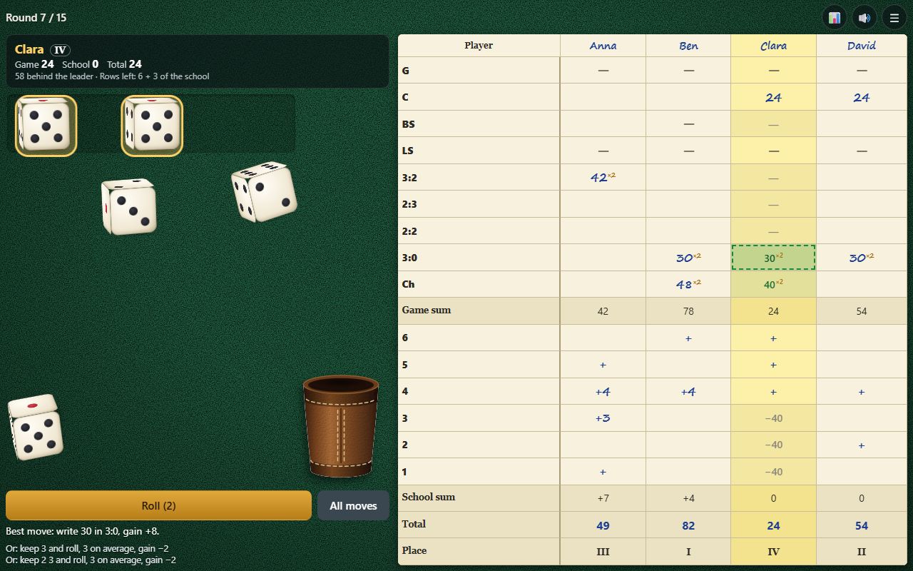

# Yatzy

*[Read in English](README.md)* · *[Читать на русском](README_RU.md)*

Tärningsspelet Yatzy, även känt som Yacht och tärningspoker, för 1–10 spelare som skickar en enhet mellan sig. Skaka läderbägaren, häll ut tärningarna på ditt bord, behåll de du vill ha och fyll i protokollet. Reglerna och raderna kommer från en familjs eget pappersprotokoll och skiljer sig från vanlig Yatzy.

Spelet går att spela på engelska, ryska eller svenska: välj språk högst upp på startskärmen.

## Så kör du

Öppna [index.html](index.html) i en webbläsare. Inget att bygga, ingen server behövs.

## Så spelar du

- Före första spelet skapar du en **grupp**: dess namn och upp till 10 spelare i turordning. Du kan ha flera grupper, var och en med egen statistik.
- På din tur kastar du upp till tre gånger. Tryck på de tärningar du vill behålla och kasta de andra.
- Efter varje kast kan du skriva in tärningarna på en ledig rad i din kolumn, även om det inte ger några poäng där. Efter 15 rundor vinner den högsta summan.
- **En kombination som skrivs in efter första kastet räknas dubbelt.**

| Rad | Namn | Kräver | Poäng |
|---|---|---|---|
| G | General | fem lika | de fem tärningarna |
| C | Fyrtal | fyra lika eller fem | de fyra tärningarna |
| BS | Stor stege | 2-3-4-5-6 | 20 |
| LS | Liten stege | 1-2-3-4-5 | 15 |
| 3:2 | Kåk, tretalet högre | tre av ett tal, två av ett lägre | de fem tärningarna |
| 2:3 | Kåk, paret högre | tre av ett tal, två av ett högre | de fem tärningarna |
| 2:2 | Två par | två par av olika tal | de fyra tärningarna |
| 3:0 | Tretal | tre lika eller fler | de tre tärningarna |
| Ch | Chans | vad som helst | de fem tärningarna |

**Skola (raderna 6 till 1):** tre tärningar med radens tal stänger raden, skrivs som `+`, inga poäng. Varje tärning utöver det lägger till talet: fyra tvåor ger 2, fem fyror ger 8. En rad som inte stängs kostar −40.

Ett oavslutat spel sparas, så du kan komma tillbaka och trycka på **Fortsätt**. **↩ Ångra** tar tillbaka en inskriven rad tills nästa spelare kastar.

## Svårighetsgrad

Nivåerna ändrar bara hjälpen, inte reglerna:

- **Lätt:** lediga rader visar vad tärningarna skulle ge, bästa draget föreslås och andra drag visas under det. **Alla drag** listar allt du kan göra nu och vinsten av varje drag.
- **Medel:** lediga rader visar vad tärningarna skulle ge, inga råd.
- **Svår:** ingen hjälp, räkna ut poängen själv.

## Bordet

Välj färg (grön, blå, vinröd, grafit, valnöt, sand) och struktur (filt, trä, läder, linne, marmor) på startskärmen eller i pausen. Där slår du också på och av **ljudet**, som även har knappen 🔊.

## Statistik

Knappen 📊 visar gruppens statistik: vinster, medelvärden, bästa och sämsta spel per spelare, medelpoäng per rad och listan över spel.

## Styrning

**Telefon och surfplatta:** spelet öppnas i helskärm. Tryck på bägaren eller Kasta, tryck på tärningar för att behålla dem och på en ledig rad för att skriva in. Protokollet rullas med fingret.

**Mus och tangentbord:** klicka på samma saker. Mellanslag kastar, tangenterna 1–5 behåller eller släpper en tärning, Esc pausar.
